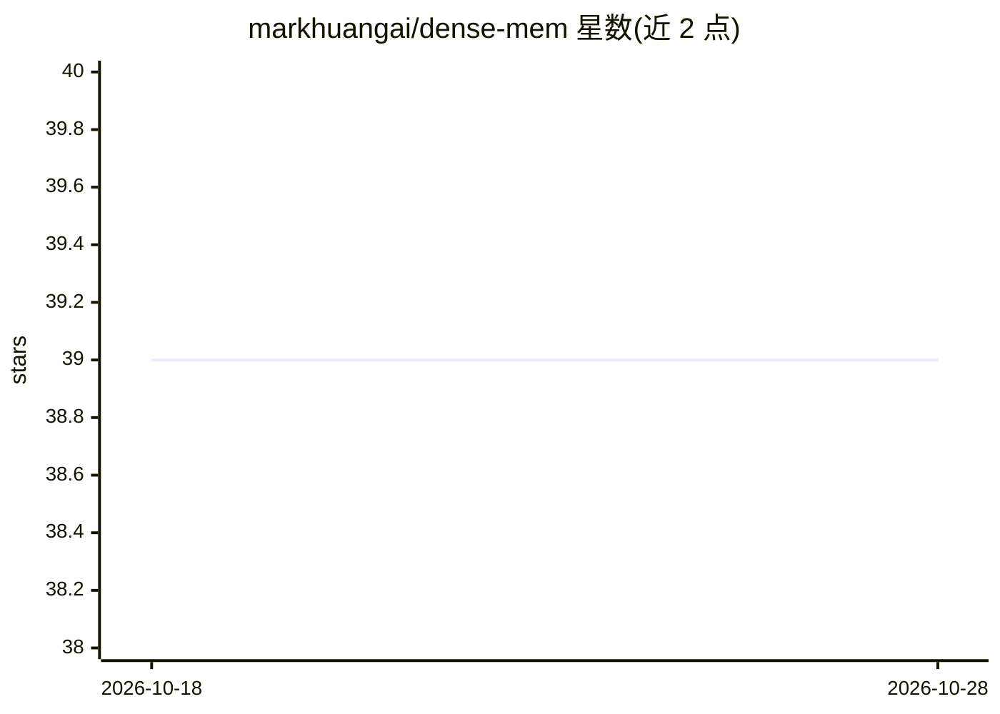

# markhuangai/dense-mem

⭐ 39 · Go · Apache-2.0 · 推送 2026-10-28 · [GitHub](https://github.com/markhuangai/dense-mem) · [官网](https://markhuang.ai/blog/ai-memory-beyond-rag) · 个人维护 · 中文 README

**自托管的 MCP 记忆服务器：为 AI agent 提供持久证据与受控召回**

独立运行的 HTTP MCP 记忆服务器（Streamable HTTP），为 AI agent 提供证据暂存、类型化声明、冲突检测、嵌入检索与图状关系召回。PostgreSQL+pgvector 为唯一持久权威，多实例部署需 Redis 协调；提供 OpenAI 兼容端点的嵌入与校验模型配置，含 Ollama 全本地方案。区分私有与团队共享记忆空间，校验模型输出仅为提案，由确定性服务端策略决定持久状态。以 Docker 镜像（GHCR）与 Compose 方式部署，提供在线演示站点。

## 筛选速览

| 维度 | 判定 | 备注 |
|---|---|---|
| AI 角色 | `ai-ecosystem` | LLM/agent 周边工具 |
| 许可风险 | `permissive` | Apache-2.0 |
| 部署形态 | `self-host` | docker 或自建部署 |
| 模型依赖 | local-ok | 支持本地模型 |
| 硬件要求 | — | 无带数字的原话,不猜 |
| 安装摩擦 | `low` | 无编译、无系统依赖或容器化 |
| 成熟度 | — | 结构信号不足 |

## 能力要点

- 证据追加式存储，生命周期操作不删除溯源
- Provider 输出仅为提案，闭模式校验与确定性服务端策略决定持久状态
- 私有/团队共享双记忆空间与所有者变更授权分离
- 任意 OpenAI 兼容端点可提供嵌入与校验，含 Ollama 全本地配置

## 适用场景

- 为 MCP 客户端的 AI agent 提供带溯源的长期记忆
- 团队内共享受权限管控的知识记忆库
- 在本地用 Ollama 搭建不依赖外部 API 的 agent 记忆服务

## 场景标签

`Agent 记忆` `知识图谱` · 领域:Agent 开发

## 证据(README 行号)

> L17: Dense-Mem is a standalone HTTP MCP memory server using Streamable HTTP. It
> L27: The external memory automation contract is MCP at `/mcp`; browser routes are
> L30: Dense-Mem is part of the research preprint

## 星数曲线

2026-10-18 39 → 2026-10-28 39（+0）

---
*卡片 v1 · prompt 1.4 · 生成 2026-10-25 · 置信度 mid · 依据 README sha `4a8b4d679bc6` · [字段定义](../../DATASET.md)*
