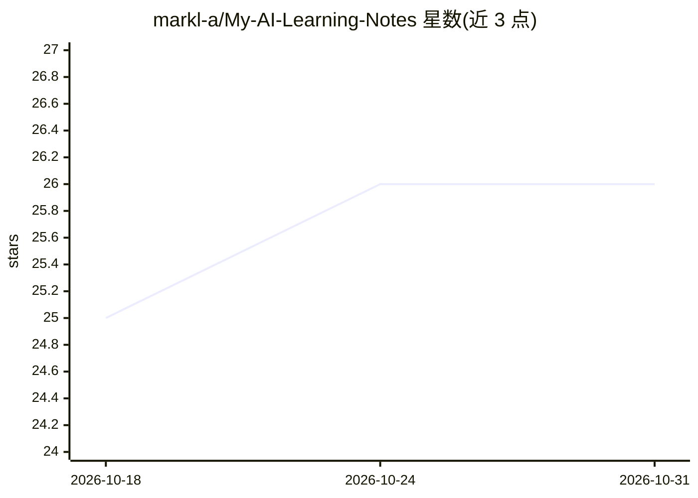

# markl-a/My-AI-Learning-Notes

⭐ 26 · Jupyter Notebook · MIT · 推送 2026-08-12 · [GitHub](https://github.com/markl-a/My-AI-Learning-Notes) · 个人维护 · 中文 README

**繁中 AI 工程師學習路徑與面試準備知識庫（22 主題）**

台灣繁體中文 AI 學習筆記倉庫：覆蓋從基礎數學到 LLM、Agent、RAG、Robotics、AI4Science 等 22 個主題的學習路徑，提供 3 條 6 個月的學習路徑（Generalist / LLM 工程師 / 應用工程師）、180+ 面試題庫、5 個 LLM 系統設計案例與 5 份可在 Colab 一鍵運行的實作 notebook（SFT-LoRA、LangGraph 多 agent、GraphRAG、vLLM 部署、DPO 對齊）。本 repo 是 phantom-mesh 生態的知識庫與面試材料庫，非 runtime 本身；內容以 markdown 為主，含術語表、概念地圖與索引文件，採 MIT 授權。

## 筛选速览

| 维度 | 判定 | 备注 |
|---|---|---|
| AI 角色 | `ai-knowledge` | 知识聚合/清单类 |
| 许可风险 | `permissive` | MIT |
| 部署形态 | `None` |  |
| 模型依赖 | — | README 未给出锁定关系 |
| 硬件要求 | — | 无带数字的原话,不猜 |
| 安装摩擦 | `low` | 无编译、无系统依赖或容器化 |
| 成熟度 | — | 结构信号不足 |

## 能力要点

- 22 個主題學習路徑，含 2024-2026 frontier deep-dive 12 章
- 5 份 Colab notebook 串聯 SFT-LoRA → DPO 的微調訓練曲線
- 180+ 面試題庫 + 5 個系統設計案例（RAG / LLM Gateway / Voice Agent 等）
- GLOSSARY、CONCEPT_MAP、FRONTIER_TERMS_INDEX 等索引文件與季度校對機制

## 适用场景

- 按 6 個月路徑系統性學習 AI / LLM 工程知識
- 準備 AI 工程師面試的白板系統設計與答題
- 在 Colab 上動手跑 LoRA 微調、GraphRAG、vLLM 部署等實作
- 查閱 2024-2026 AI 研究前沿論文與熱詞索引

## 场景标签

`教程课程` · 领域:学习与行业

## 证据(README 行号)

> L3: > 台灣繁體中文 | 從基礎數學到 LLM、Agent、RAG、Robotics、AI4Science 等 **22 個主題** 的完整 AI 工程師學習路徑筆記
> L23: 本知識庫是 phantom-mesh(自託管多 agent AI runtime)生態系的**學習路徑 + 面試準備教材**。本 repo **不是 runtime 本身**,而是知識庫與面試材料庫。
> L65: |5|AI 研究前沿 2024-2025|50 篇關鍵論文索引 + Vibe Coding 學習指南 + 4 個實戰專案|

## 星数曲线

2026-10-18 25 → 2026-10-31 26（+1）

---
*卡片 v1 · prompt 1.4 · 生成 2026-10-26 · 置信度 high · 依据 README sha `ea911d8590b2` · [字段定义](../../DATASET.md)*
