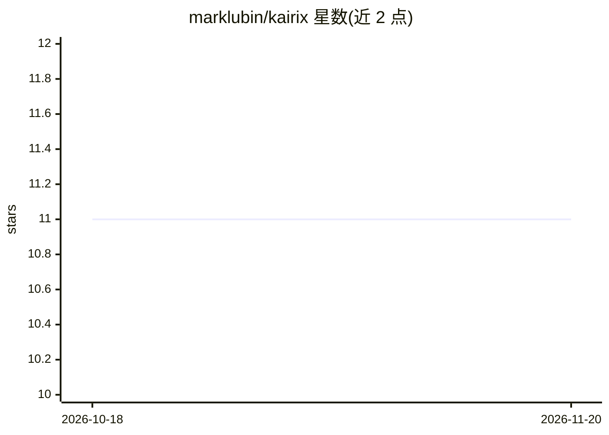

# marklubin/kairix

⭐ 11 · Python · 推送 2026-02-08 · [GitHub](https://github.com/marklubin/kairix) · 个人维护

**语音优先个人 AI agent 研究项目：跨会话持久记忆与后台反思**

一个探索性研究项目，构建具备跨会话持久记忆的语音优先 AI agent。历经三代迭代：v0 用 Gradio 做对话持久化实验；v1 自研认知引擎（分层语义图记忆、多 agent 事实抽取、离线反思流水线、React 语音 UI、Twilio 电话绑定）；v2 基于 Pipecat 与 Letta 重建，含实时语音对话、会话边界检测、后台摘要与分层记忆。附 Kotlin 跨平台 iOS 应用，可实时展示 agent 后台思考。主要面向个人 AI 研究与开发探索，README 未给出安装运行步骤。

## 筛选速览

| 维度 | 判定 | 备注 |
|---|---|---|
| AI 角色 | `ai-native` | 本体是模型或模型工具 |
| 许可风险 | `none` | — |
| 部署形态 | `None` |  |
| 模型依赖 | — | README 未给出锁定关系 |
| 硬件要求 | — | 无带数字的原话,不猜 |
| 安装摩擦 | `low` | 无编译、无系统依赖或容器化 |
| 成熟度 | `idea` | |

## 能力要点

- 分层记忆体系：会话→日→主题级摘要与核心记忆块
- 后台反思流水线：独立 Reflector agent 做摘要与洞察生成
- ChatGPT 历史会话导入以引导构建长期记忆
- Pipecat 语音管线：Deepgram STT、ElevenLabs TTS、VAD、WebSocket 流式

## 适用场景

- 探索 agent 长期记忆与后台反思机制的研究实验
- 与个人语音 AI 助手进行持续对话
- 导入多年 ChatGPT 历史构建个人记忆库

## 场景标签

`语音 Agent` `Agent 记忆` `AI 助手` · 领域:Agent 开发

## 证据(README 行号)

> L4: A voice-first AI agent with persistent memory across conversations.
> L62: - **Pipecat** — Voice pipeline (Deepgram STT, ElevenLabs TTS, VAD, WebSocket streaming)
> L63: - **Letta** — Hierarchical memory with archival/core memory blocks, agent orchestration

## 星数曲线

2026-10-18 11 → 2026-11-20 11（+0）

---
*卡片 v1 · prompt 1.4 · 生成 2026-11-19 · 置信度 high · 依据 README sha `95fca7b8c162` · [字段定义](../../DATASET.md)*
