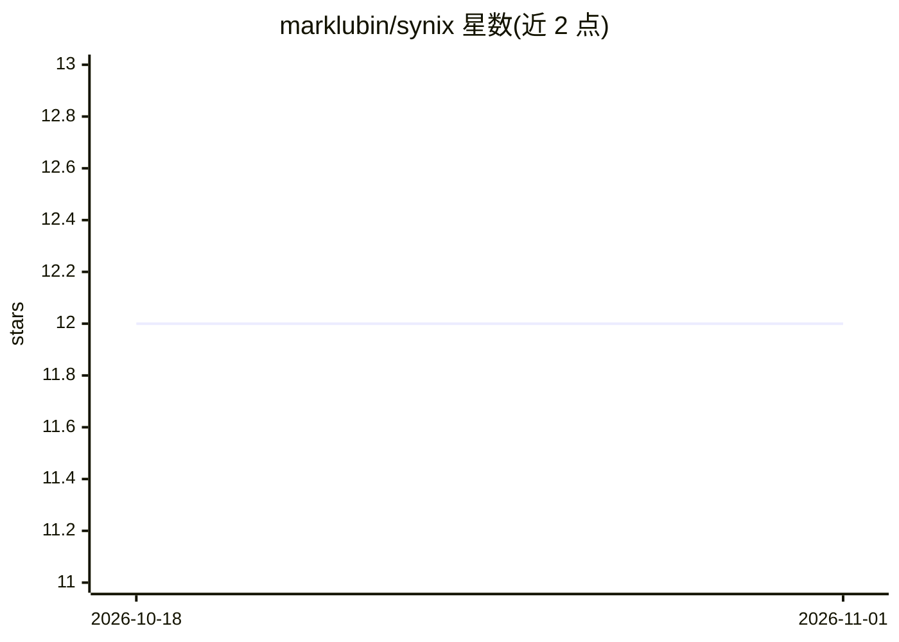

# marklubin/synix

⭐ 12 · Python · MIT · 推送 2026-04-29 · [GitHub](https://github.com/marklubin/synix) · [官网](https://synix.dev) · 个人维护

**面向 AI agent 的可编程记忆架构构建工具**

以 Python 定义的有向图流水线（sources → transforms → artifacts）从原始数据生成结构化 agent 记忆：LLM 摘要、按月汇总、核心记忆文档与全文搜索索引，每条输出可溯源到原始来源。架构修改只增量重建受影响层，无需迁移。运行离线解耦，另提供知识服务器（MCP HTTP）、Claude Code 插件、CLI 与 Python SDK。作者自述为 pre-1.0、单人维护项目，实时运行时与多租户尚未实现。

## 筛选速览

| 维度 | 判定 | 备注 |
|---|---|---|
| AI 角色 | `ai-ecosystem` | LLM/agent 周边工具 |
| 许可风险 | `permissive` | MIT |
| 部署形态 | `None` |  |
| 模型依赖 | — | README 未给出锁定关系 |
| 硬件要求 | — | 无带数字的原话,不猜 |
| 安装摩擦 | `low` | 无编译、无系统依赖或容器化 |
| 成熟度 | `idea` | |

## 能力要点

- Python 定义的可编程记忆流水线，修改后仅增量重建受影响层
- 全链路溯源（artifact → source）与混合搜索模式
- 知识服务器 synix serve 提供 MCP HTTP、桶式摄取与自动构建
- 6 个项目模板覆盖 agent 记忆、RAG、团队知识库等场景

## 适用场景

- 为 agent 构建跨会话记忆并控制记忆的分层结构
- A/B 测试不同记忆架构（如按主题 vs 按月汇总）
- 将照片库、代码库、IoT 数据流加工为可搜索的知识工件

## 场景标签

 · 领域:AI agent 基础设施/记忆系统

## 证据(README 行号)

> L27: Synix processed your sources through a **pipeline** — a directed graph of transforms you define in Python:
> L58: **Agent integration:** For always-on memory, run `synix serve` — a knowledge server with bucket-based ingestion, se
> L138: Synix is not a memory store. Mem0/Letta/Graphiti store and retrieve memories. Synix is the system that **produces*

## 星数曲线

2026-10-18 12 → 2026-11-01 12（+0）

---
*卡片 v1 · prompt 1.4 · 生成 2026-11-01 · 置信度 high · 依据 README sha `418a0e385a34` · [字段定义](../../DATASET.md)*
