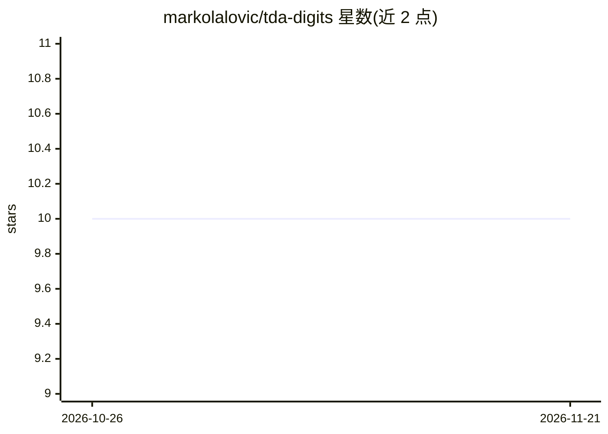

# markolalovic/tda-digits

⭐ 10 · Python · 推送 2026-10-25 · [GitHub](https://github.com/markolalovic/tda-digits) · [官网](https://tdadigits.pages.dev/) · 个人维护

**教程代码库：在 MNIST 手写数字上提取拓扑特征**

计算拓扑在机器学习中应用的教程源码仓库：用持续同调（Dionysus 2 计算）从 MNIST 手写数字图像提取拓扑特征，并配合 Scikit-learn 的分类算法进行演示。工作流分三步：运行脚本下载 1 万张数字图像并保存为 NumPy 数组、运行特征提取脚本生成示例图形、通过两个 Jupyter notebook 查看函数与类的详细用法。依赖 Python 3 及 Boost（Dionysus 2 所需）。

## 筛选速览

| 维度 | 判定 | 备注 |
|---|---|---|
| AI 角色 | `ai-knowledge` | 知识聚合/清单类 |
| 许可风险 | `none` | — |
| 部署形态 | `None` |  |
| 模型依赖 | — | README 未给出锁定关系 |
| 硬件要求 | — | 无带数字的原话,不猜 |
| 安装摩擦 | `low` | 无编译、无系统依赖或容器化 |
| 成熟度 | — | 结构信号不足 |

## 能力要点

- 用 Dionysus 2 计算 MNIST 数字的持续同调特征
- 脚本下载并保存 1 万张数字图像为 NumPy 数组
- 提供 Example.ipynb 与 Classification.ipynb 两个教程 notebook
- 引用持续条码代数函数相关论文与 Dionysus 2 文档

## 适用场景

- 学习如何将持续同调用于图像数据特征提取
- 复现 MNIST 拓扑特征分类的教学示例
- 为拓扑数据分析课程寻找演示代码

## 场景标签

`教程课程` · 领域:学习与行业

## 证据(README 行号)

> L7: This repository contains source code for a tutorial on applying computational topology in machine learning. To demon
> L18: - Dionysus 2 for computing persistent homology

## 星数曲线

2026-10-26 10 → 2026-11-21 10（+0）

---
*卡片 v1 · prompt 1.4 · 生成 2026-11-19 · 置信度 high · 依据 README sha `01b18a967a86` · [字段定义](../../DATASET.md)*
