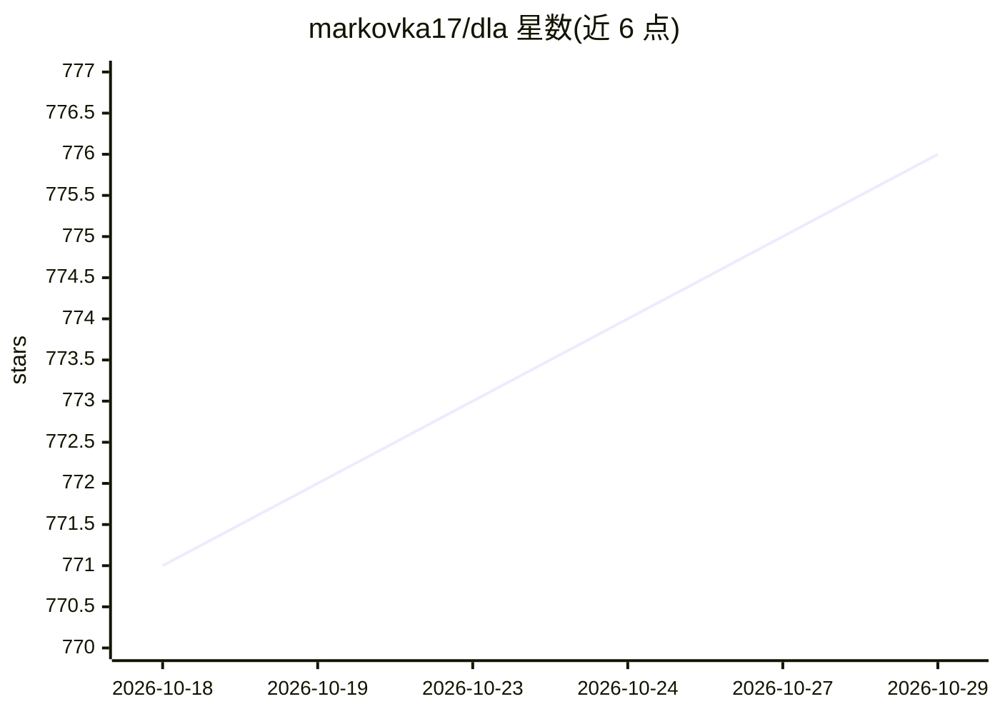

# markovka17/dla

⭐ 776 · Jupyter Notebook · MIT · 推送 2026-10-28 · [GitHub](https://github.com/markovka17/dla) · 组织维护

**HSE 音频深度学习课程讲义与研讨会材料库**

莫斯科高等经济大学（HSE）CS 系开设的 Deep Learning for Audio 课程仓库，按周组织讲义与研讨会材料，内容涵盖数字信号处理、自动语音识别（CTC、Whisper、RNN-T）、关键词检测、说话人验证等主题。提供作业与项目模板、YouTube 俄语授课录像（部分周有英语录像），并保留 2020-2025 年历史版本。2026 秋季为当前版本，多数周次内容与作业标注 TBA。

## 筛选速览

| 维度 | 判定 | 备注 |
|---|---|---|
| AI 角色 | `ai-knowledge` | 知识聚合/清单类 |
| 许可风险 | `permissive` | MIT |
| 部署形态 | `None` |  |
| 模型依赖 | — | README 未给出锁定关系 |
| 硬件要求 | — | 无带数字的原话,不猜 |
| 安装摩擦 | `low` | 无编译、无系统依赖或容器化 |
| 成熟度 | — | 结构信号不足 |

## 能力要点

- 按周组织的音频深度学习课程材料（DSP、ASR 等）
- 涵盖 CTC、Whisper、RNN-T 等语音识别技术主题
- 提供课程项目模板与历年版本（2020-2025）
- YouTube 俄语授课录像，部分周次有英语录像

## 适用场景

- 按周自学音频深度学习课程内容
- 查找语音识别相关讲义与实践材料
- 参考课程项目模板布置作业或项目

## 场景标签

`教程课程` · 领域:学习与行业

## 证据(README 行号)

> L5: - Lecture and seminar materials for each week are in `./week*` folders, see `README.md` for materials and instructio
> L7: - The current version of the course is conducted in **autumn 2026** at the CS Faculty of HSE.
> L26:  - Lecture: Metrics, Datasets, Connectionist Temporal Classification (CTC), DeepSpeech2, Conformer, Beam Search, La

## 星数曲线

2026-10-18 771 → 2026-10-29 776（+5）

---
*卡片 v1 · prompt 1.4 · 生成 2026-10-21 · 置信度 high · 依据 README sha `5aed6b08c51b` · [字段定义](../../DATASET.md)*
