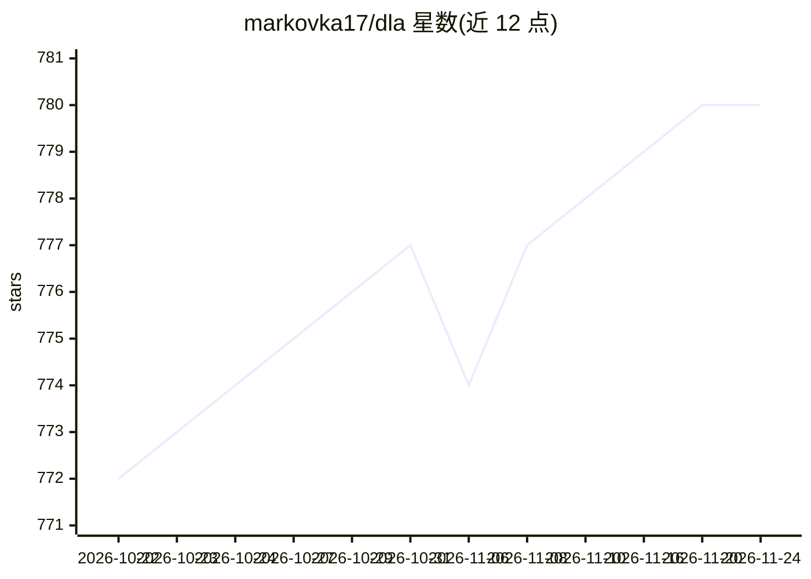

# markovka17/dla

⭐ 780 · Jupyter Notebook · MIT · 推送 2026-11-08 · [GitHub](https://github.com/markovka17/dla) · 组织维护

**HSE 语音方向深度学习课程的教学材料仓库**

HSE 计算机系秋季课程《Deep Learning for Audio》的讲义与研讨课材料仓库，按周组织于 week* 目录。内容覆盖数字信号处理（傅里叶变换、梅尔频谱、MFCC）、语音识别三讲（CTC、DeepSpeech2、Conformer、Whisper、wav2vec 2.0、HuBERT 等）、源分离与去噪（Demucs、DCCRN 等），并提供 YouTube 录课（俄语为主，部分周有英语版）、项目模板与 2020-2025 历年版本链接。课程进行至 week06，后续周与作业标注 TBA。

## 筛选速览

| 维度 | 判定 | 备注 |
|---|---|---|
| AI 角色 | `ai-knowledge` | 知识聚合/清单类 |
| 许可风险 | `permissive` | MIT |
| 部署形态 | `None` |  |
| 模型依赖 | — | README 未给出锁定关系 |
| 硬件要求 | — | 无带数字的原话,不猜 |
| 安装摩擦 | `low` | 无编译、无系统依赖或容器化 |
| 成熟度 | — | 结构信号不足 |

## 能力要点

- 按周组织的讲义与研讨课材料（week* 目录）
- 覆盖 DSP、ASR（CTC/Whisper/wav2vec 2.0/HuBERT）、源分离等主题
- 提供项目模板与 YouTube 录课（俄语为主，部分英语）
- 保留 2020-2025 历年课程版本链接

## 适用场景

- 系统学习音频深度学习与语音识别基础知识
- 配合课程周目录查找讲义与研讨材料
- 参考其项目模板搭建语音相关作业工程

## 场景标签

`教程课程` · 领域:学习与行业

## 证据(README 行号)

> L3: # Deep Learning for Audio (DLA)
> L7: - The current version of the course is conducted in **autumn 2026** at the CS Faculty of HSE.
> L11: # Syllabus

## 星数曲线

2026-10-22 772 → 2026-11-24 780（+8）

---
*卡片 v1 · prompt 1.4 · 生成 2026-11-24 · 置信度 high · 依据 README sha `1b60c6660ff4` · [字段定义](../../DATASET.md)*
