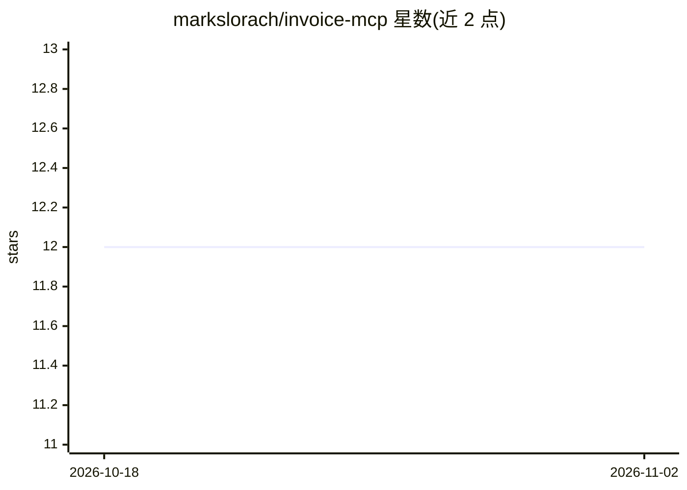

# markslorach/invoice-mcp

⭐ 12 · TypeScript · MIT · 推送 2026-08-07 · [GitHub](https://github.com/markslorach/invoice-mcp) · 个人维护

**用自然语言生成专业 PDF 发票的 MCP 服务器**

基于 Model Context Protocol SDK 与 TypeScript 构建的 MCP 服务器，供 Claude Desktop 等 AI 客户端通过自然语言对话创建 PDF 发票（使用 React PDF 渲染）。支持可选 logo（需直链 JPG/PNG/WebP，不支持 SVG），生成前会引导确认或补充缺失信息；另带 Vite+React 19 预览应用可编辑发票模板。正在测试经 LM Studio 接本地模型，但作者声明本地模型可靠性低于 Claude 且可能报错；路线图中报价单生成与模板改进尚未完成。需 Node v18+，从源码克隆构建安装。

## 筛选速览

| 维度 | 判定 | 备注 |
|---|---|---|
| AI 角色 | `ai-ecosystem` | LLM/agent 周边工具 |
| 许可风险 | `permissive` | MIT |
| 部署形态 | `library` | 以包/库形式分发 |
| 模型依赖 | — | README 未给出锁定关系 |
| 硬件要求 | — | 无带数字的原话,不猜 |
| 安装摩擦 | `low` | 无编译、无系统依赖或容器化 |
| 成熟度 | `idea` | |

## 能力要点

- 自然语言驱动生成 PDF 发票（MCP 工具）
- 可选 logo：需直链 JPG/PNG/WebP，不支持 SVG
- React 预览应用实时编辑发票模板
- 测试中支持 LM Studio 本地模型

## 适用场景

- 在 Claude Desktop 对话中直接创建 PDF 发票
- 按预填业务信息批量、格式一致地开票
- 需要报价或发票的 freelancer/小企业主快速出单

## 场景标签

 · 领域:文档生成/办公自动化

## 证据(README 行号)

> L5: A Model Context Protocol server for creating professional PDF invoices using natural language.
> L125: - Model Context Protocol SDK

## 星数曲线

2026-10-18 12 → 2026-11-02 12（+0）

---
*卡片 v1 · prompt 1.4 · 生成 2026-11-01 · 置信度 mid · 依据 README sha `1fdb4159a153` · [字段定义](../../DATASET.md)*
