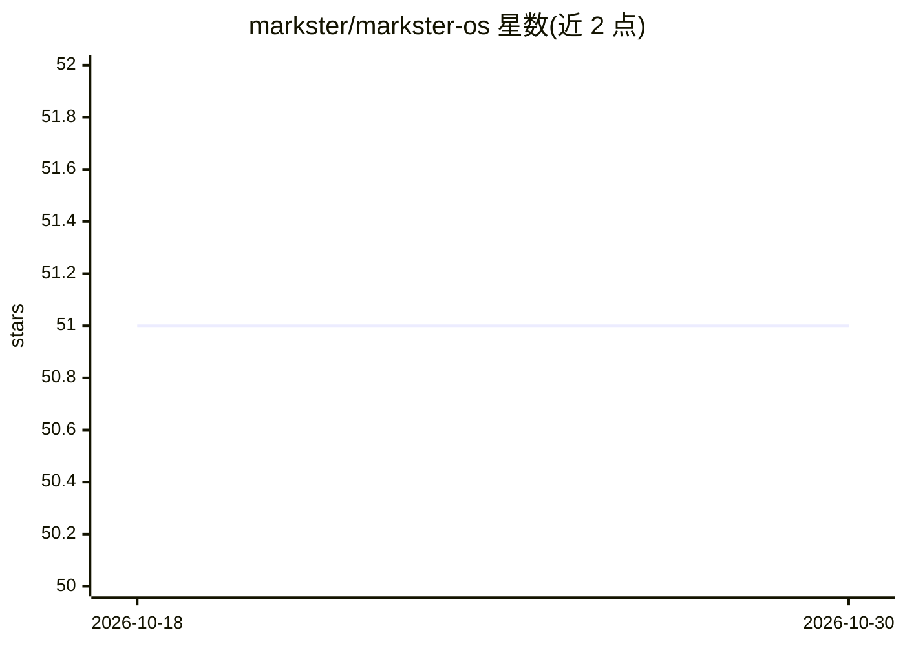

# markster/markster-os

⭐ 51 · Python · NOASSERTION · 推送 2026-05-15 · [GitHub](https://github.com/markster/markster-os) · [官网](https://markster.ai/) · 组织维护

**在 AI agent 内运行的 B2B 销售/GTM 方法论与技能体系**

Markster OS 是一套基于 ScaleOS 方法论的 B2B GTM（进入市场）操作系统，以 Markdown 方法论文档、playbooks、7 个核心技能与 23 个专家 persona 技能文件的形式运行在 Claude、GPT、Gemini、Codex、OpenClaw 等 AI 环境中。用户通过 markster-os CLI 创建工作区，填写 company-context/ 定义 ICP 与业务上下文，技能按 CHECK/DO/VERIFY 结构执行冷邮件、LinkedIn 触达、销售、融资等序列，并有学习循环将对话沉淀为业务知识。核心内容 MIT 免费，另提供付费 API 附加组件（数据/情报类）。

## 筛选速览

| 维度 | 判定 | 备注 |
|---|---|---|
| AI 角色 | `ai-knowledge` | 知识聚合/清单类 |
| 许可风险 | `none` | NOASSERTION |
| 部署形态 | `None` |  |
| 模型依赖 | locked-api |  |
| 硬件要求 | — | 无带数字的原话,不猜 |
| 安装摩擦 | `low` | 无编译、无系统依赖或容器化 |
| 成熟度 | — | 结构信号不足 |

## 能力要点

- ScaleOS 方法论：F1-F4 基础决策 + GOD Engine 9 个执行砖块
- 7 个核心技能按 CHECK/DO/VERIFY 结构执行并验证指标
- markster-os CLI 管理工作区、Git 钩子与校验（markster-os validate）
- 支持安装到 OpenClaw 共享技能目录（~/.openclaw/skills）

## 适用场景

- B2B 创业者在 Claude/Gemini 等 AI 环境中运行冷邮件与外联 playbook
- 团队用 Git 工作区维护公司上下文并按周运行 Autopilot 诊断循环
- 按业务类型（SaaS、咨询、home services 等 13 类）选择对应 playbook

## 场景标签

`Agent 框架` · 领域:Agent 开发

## 证据(README 行号)

> L37: **Repo type:** B2B GTM operating system -- ScaleOS methodology (Foundation F1-F4 + GOD Engine 9 bricks)
> L52: |`skills/`|7 core operator skills (CHECK/DO/VERIFY) + 23 specialist persona skills|
> L121: |**Extended skill library**|30 public skill files in the repo, including specialist advisors, copywriters, prep to

## 星数曲线

2026-10-18 51 → 2026-10-30 51（+0）

---
*卡片 v1 · prompt 1.4 · 生成 2026-10-24 · 置信度 mid · 依据 README sha `ee7c4a7e0df3` · [字段定义](../../DATASET.md)*
