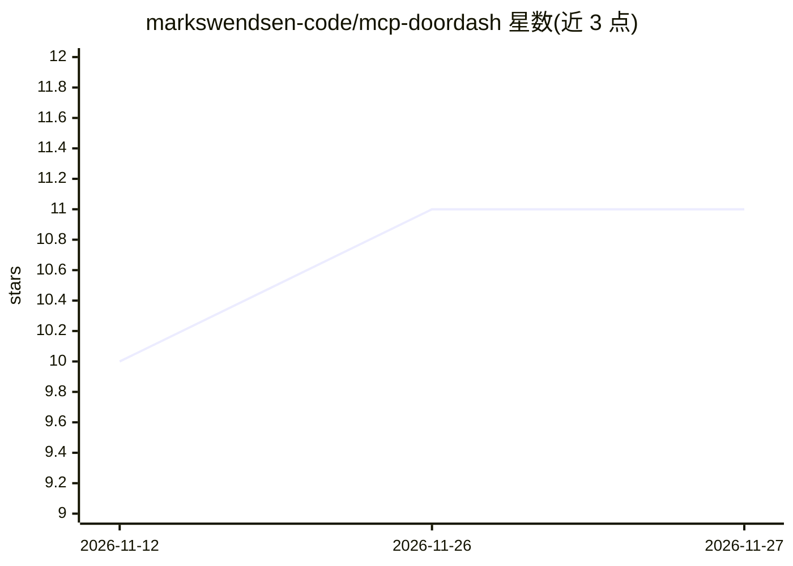

# markswendsen-code/mcp-doordash

⭐ 11 · TypeScript · 推送 2026-04-21 · [GitHub](https://github.com/markswendsen-code/mcp-doordash) · [官网](https://www.npmjs.com/package/@striderlabs/mcp-doordash) · 组织维护

**让 AI agent 通过 MCP 下单 DoorDash 外卖的连接器**

以 MCP server 形式发布的 DoorDash 连接器：向 agent 暴露搜索餐厅、浏览菜单、加购物车、确认下单、追踪订单等工具，支持持久会话、自动 MFA 处理与按用户加密存储凭据。因 DoorDash 无公开 API，通过 Playwright 浏览器自动化交互，含 UI 变更检测、限速与指纹伪装等机制。面向 Claude Desktop 用户与 agent 开发者，npm 安装或自托管。

## 筛选速览

| 维度 | 判定 | 备注 |
|---|---|---|
| AI 角色 | `ai-ecosystem` | LLM/agent 周边工具 |
| 许可风险 | `permissive` | — |
| 部署形态 | `library` | 以包/库形式分发 |
| 模型依赖 | — | README 未给出锁定关系 |
| 硬件要求 | — | 无带数字的原话,不猜 |
| 安装摩擦 | `low` | 无编译、无系统依赖或容器化 |
| 成熟度 | — | 结构信号不足 |

## 能力要点

- MCP server 暴露搜索/菜单/购物车/下单/追踪等工具
- 基于 Playwright 浏览器自动化，因 DoorDash 无公开 API
- 持久会话、自动 MFA、按用户加密凭据存储
- npm 安装与源码自托管两种途径

## 适用场景

- 在 Claude Desktop 中用对话下单外卖
- 为个人 AI agent 接入外卖下单执行能力
- 本地自托管管理自己的 DoorDash 账号会话

## 场景标签

 · 领域:AI agent 工具/自动化

## 证据(README 行号)

> L3: **Order food delivery via DoorDash using AI agents**
> L10: Part of Strider Labs — action execution for personal AI agents.

## 星数曲线

2026-11-12 10 → 2026-11-27 11（+1）

---
*卡片 v1 · prompt 1.4 · 生成 2026-11-19 · 置信度 high · 依据 README sha `387d6e3b24ec` · [字段定义](../../DATASET.md)*
