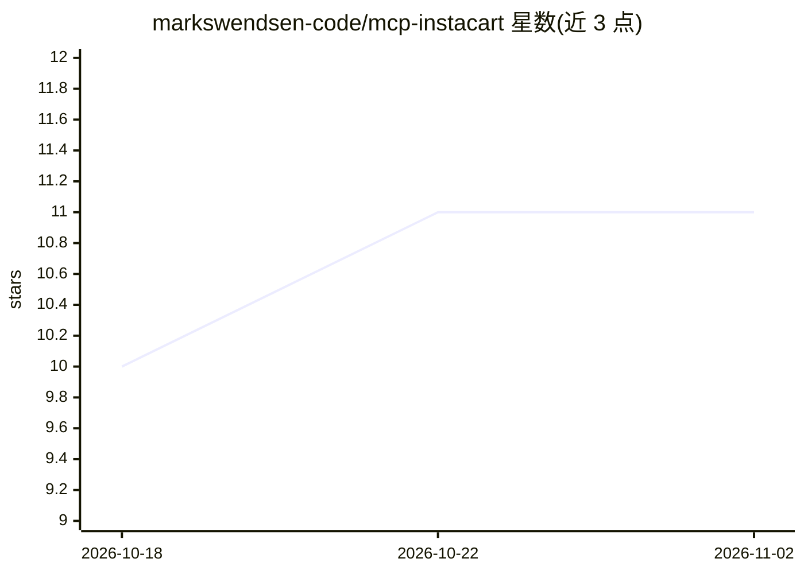

# markswendsen-code/mcp-instacart

⭐ 11 · TypeScript · 推送 2026-06-11 · [GitHub](https://github.com/markswendsen-code/mcp-instacart) · [官网](https://www.npmjs.com/package/@striderlabs/mcp-instacart) · 组织维护

**让 AI agent 通过 MCP 在 Instacart 下单买菜的服务器**

面向 Claude Desktop 等 MCP 客户端的 Instacart 连接器：通过 Playwright 浏览器自动化（Instacart 无公开 API）实现商品搜索、浏览商店、加购物车、下单、跟踪订单等能力。使用持久浏览器配置文件与加密会话存储保持登录，支持 OAuth 刷新、MFA 处理与按用户隔离的凭据。以 npm 包或 npx 方式安装，也可 git clone 自托管；首次登录需设置非 headless 模式在真实浏览器窗口登录。

## 筛选速览

| 维度 | 判定 | 备注 |
|---|---|---|
| AI 角色 | `ai-ecosystem` | LLM/agent 周边工具 |
| 许可风险 | `permissive` | — |
| 部署形态 | `library` | 以包/库形式分发 |
| 模型依赖 | — | README 未给出锁定关系 |
| 硬件要求 | — | 无带数字的原话,不猜 |
| 安装摩擦 | `low` | 无编译、无系统依赖或容器化 |
| 成熟度 | — | 结构信号不足 |

## 能力要点

- 商品搜索、加购、下单、跟踪订单等完整买菜流程
- Playwright 浏览器自动化连接无公开 API 的 Instacart
- 持久加密会话、OAuth 刷新与 MFA 处理
- npm/npx 安装，支持 Claude Desktop 配置接入

## 适用场景

- 让 Claude 等 agent 代为在 Instacart 下单日常食品杂货
- 通过自然语言查询商品与商店库存
- 复用已保存的收藏商品快速下单

## 场景标签

`浏览器自动化` · 领域:效率与自动化

## 证据(README 行号)

> L3: **Order groceries via Instacart using AI agents**
> L20:   "mcpServers": {

## 星数曲线

2026-10-18 10 → 2026-11-02 11（+1）

---
*卡片 v1 · prompt 1.4 · 生成 2026-11-02 · 置信度 high · 依据 README sha `82db4f3508b4` · [字段定义](../../DATASET.md)*
