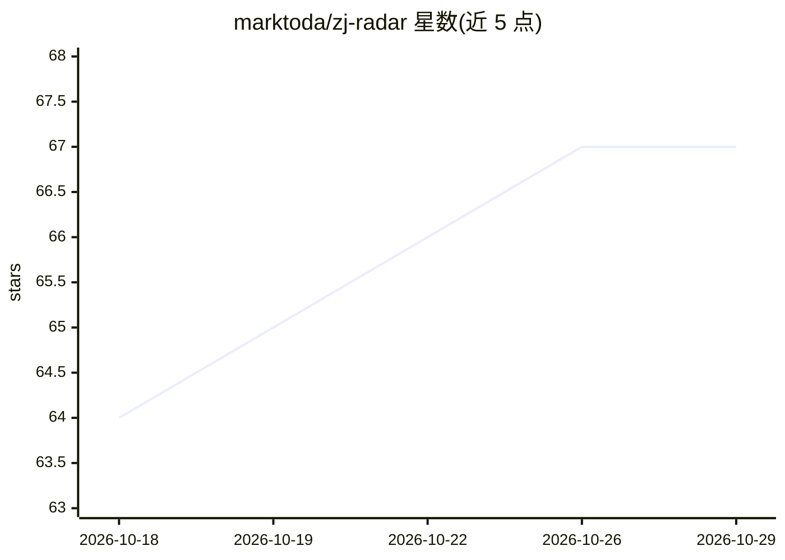

# marktoda/zj-radar

⭐ 67 · Rust · MIT · 推送 2026-10-15 · [GitHub](https://github.com/marktoda/zj-radar) · [官网](https://crates.io/crates/zj-radar) · 个人维护

**Zellij 侧栏插件：集中显示多标签页内各 AI agent 的实时状态**

以 Zellij 插件（WASM）+ CLI 形式提供的侧边栏状态栏：通过 Claude Code、Codex、Opencode、pi、omp 的 hooks/插件广播版本化 JSON 载荷（zj_radar.status.v1），经 zellij pipe 推送到侧栏，按标签页/窗格聚合渲染 working/needs you/done/error 状态，支持点击跳转、attention-next 键绑定、后台子任务行、桌面通知与跨会话切换。插件为推送驱动、不轮询窗格；也显示 shell 命令（构建/测试/dev server）状态。要求 Zellij 0.44.3+，Linux 与 Apple Silicon macOS 提供预编译 CLI，Intel macOS 需源码构建。

## 筛选速览

| 维度 | 判定 | 备注 |
|---|---|---|
| AI 角色 | `ai-ecosystem` | LLM/agent 周边工具 |
| 许可风险 | `permissive` | MIT |
| 部署形态 | `desktop` | 安装包/桌面程序 |
| 模型依赖 | — | README 未给出锁定关系 |
| 硬件要求 | — | 无带数字的原话,不猜 |
| 安装摩擦 | `low` | 无编译、无系统依赖或容器化 |
| 成熟度 | — | 结构信号不足 |

## 能力要点

- 按标签页/窗格显示 Claude Code、Codex、Opencode、pi、omp 的 agent 状态，并支持任意可发 JSON 的脚本作为生产者
- 推送驱动架构：不轮询窗格，事件路径上无阻塞主机调用
- 点击或键绑定跳转到需要用户关注的标签页；含后台子任务行、桌面通知、跨 Zellij 会话计数与切换
- 预编译 CLI 安装脚本与 zj-radar setup/update 命令，源码、Nix、手动安装路径见 docs/install.md

## 适用场景

- 同时跑多个 AI agent 时一眼看到哪个在等授权、哪个已完成
- 在现有 Zellij 会话内集中跟踪各标签页的构建、测试与 dev server 状态
- agent 完成或需要输入时收到桌面通知，避免遗漏

## 场景标签

 · 领域:开发者工具/终端多路复用

## 证据(README 行号)

> L3: A Zellij sidebar that shows what every AI agent in your
> L69: - Per-tab and per-pane status for Claude Code, Codex, Opencode, pi, and
> L88: Agent hooks broadcast a small versioned JSON payload (`zj_radar.status.v1`)

## 星数曲线

2026-10-18 64 → 2026-10-29 67（+3）

---
*卡片 v1 · prompt 1.4 · 生成 2026-10-24 · 置信度 high · 依据 README sha `fdd348088fbc` · [字段定义](../../DATASET.md)*
