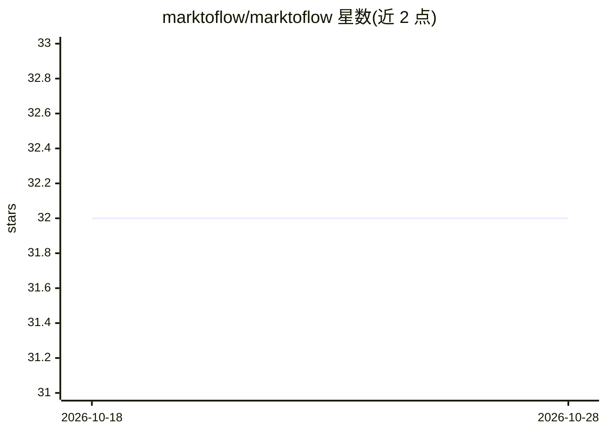

# marktoflow/marktoflow

⭐ 32 · TypeScript · MIT · 推送 2026-06-08 · [GitHub](https://github.com/marktoflow/marktoflow) · [官网](https://github.com/scottgl9/skelm) · 组织维护

**以 Markdown+YAML 编写工作流的 CLI 原生 AI 自动化框架**

开源工作流自动化框架，工作流即带 YAML frontmatter 的 .md 文件，可 Git 版本化与审计。通过 Claude CLI、GitHub Copilot、Codex、Gemini 订阅登录运行 agent，无需 AI API key，也支持 Ollama、llama.cpp、VLLM 等本地模型及 OpenAI SDK 适配；另有 ACP 变体与原生 MCP 支持。提供 39 个带 TypeScript 类型的服务集成（Slack/Jira/Gmail 等）、并行多 agent 执行、JSON Schema 结构化输出、成本跟踪与可选的可视化设计器 GUI。自托管、无遥测，MIT 许可。需 Node.js 环境，经 npm 安装。

## 筛选速览

| 维度 | 判定 | 备注 |
|---|---|---|
| AI 角色 | `ai-ecosystem` | LLM/agent 周边工具 |
| 许可风险 | `permissive` | MIT |
| 部署形态 | `library` | 以包/库形式分发 |
| 模型依赖 | local-ok | 支持本地模型 |
| 硬件要求 | — | 无带数字的原话,不猜 |
| 安装摩擦 | `low` | 无编译、无系统依赖或容器化 |
| 成熟度 | — | 结构信号不足 |

## 能力要点

- 工作流为 markdown+YAML 文件，可 diff、版本控制
- 复用 Copilot/Claude/Codex/Gemini 订阅登录，无需 API key
- 39 个 SDK 集成（Slack、Jira、Gmail、Stripe 等）
- 支持 Ollama/llama.cpp/VLLM 本地模型与离线运行，MCP/ACP 支持

## 适用场景

- 通过 Slack/Telegram 给 AI agent 派发编码任务并回收结构化结果
- 在敏感数据不出本机的前提下跑自动化与多 agent 代码评审
- 把审批、站会、事件响应等团队流程写成可版本化的工作流

## 场景标签

`工作流自动化` `多智能体` · 领域:Agent 开发

## 证据(README 行号)

> L5:  Open-source AI workflow automation — your workflows are just markdown files.
> L63: |**AI tool calling**|Agentic loops — models call tools, get results, and reason autonomously|
> L122: ## Integrations

## 星数曲线

2026-10-18 32 → 2026-10-28 32（+0）

---
*卡片 v1 · prompt 1.4 · 生成 2026-10-26 · 置信度 high · 依据 README sha `8d9f7bd9b5ec` · [字段定义](../../DATASET.md)*
