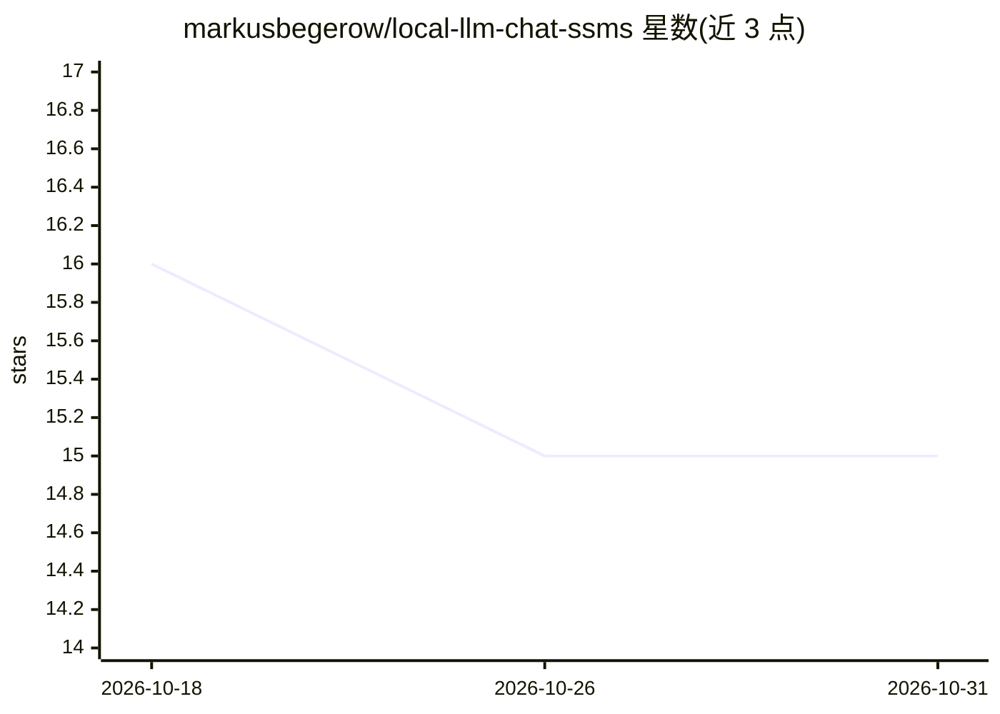

# markusbegerow/local-llm-chat-ssms

⭐ 15 · C# · GPL-2.0 · 推送 2026-10-16 · [GitHub](https://github.com/markusbegerow/local-llm-chat-ssms) · 个人维护

**SQL Server Management Studio 的本地 LLM 聊天扩展，离线私有**

面向 SSMS 用户的 .NET 聊天扩展：在 Management Studio 内嵌聊天窗口，通过 Ollama、LM Studio、OpenAI 兼容端点或自定义 API 与本地大模型对话，默认系统提示词面向 T-SQL 与数据库任务。支持会话内历史保持、/read /search /list 等斜杠命令读写 SQL 脚本与浏览目录，数据默认不出本机。以 VSIX 安装包或 Visual Studio 源码构建方式提供，要求 SSMS 19+ 与 .NET Framework 4.7.2、64 位架构。

## 筛选速览

| 维度 | 判定 | 备注 |
|---|---|---|
| AI 角色 | `ai-native` | 本体是模型或模型工具 |
| 许可风险 | `viral` | GPL-2.0 |
| 部署形态 | `desktop` | 安装包/桌面程序 |
| 模型依赖 | local-ok | 支持本地模型 |
| 硬件要求 | — | 无带数字的原话,不猜 |
| 安装摩擦 | `low` | 无编译、无系统依赖或容器化 |
| 成熟度 | — | 结构信号不足 |

## 能力要点

- SSMS 原生聊天窗口，接入 Ollama/LM Studio/OpenAI 兼容端点
- 斜杠命令读取/搜索/列出 SQL 脚本并纳入对话上下文
- 默认全程本地运行，无数据外发
- 提供 VSIX 安装包与源码构建两种安装途径

## 适用场景

- 在 SSMS 内直接向本地 LLM 询问 T-SQL 与数据库优化问题
- 把本地 SQL 脚本读入上下文让 AI 审查或生成代码
- 在内网/隐私要求环境下离线使用 AI 编码助手

## 场景标签

`AI 助手` `代码生成` · 领域:编码与开发

## 证据(README 行号)

> L9: **A powerful SSMS extension for chatting with local Large Language Models directly in SQL Server Management Studio—c
> L17: - **Multiple LLM Support**: Works with Ollama, LM Studio, OpenAI-compatible endpoints, and custom APIs
> L236: - **SSMS**: Version 19.0 or higher (supports 18.x, 19.x, 20+)

## 星数曲线

2026-10-18 16 → 2026-10-31 15（-1）

---
*卡片 v1 · prompt 1.4 · 生成 2026-10-30 · 置信度 high · 依据 README sha `321767cbb6dd` · [字段定义](../../DATASET.md)*
