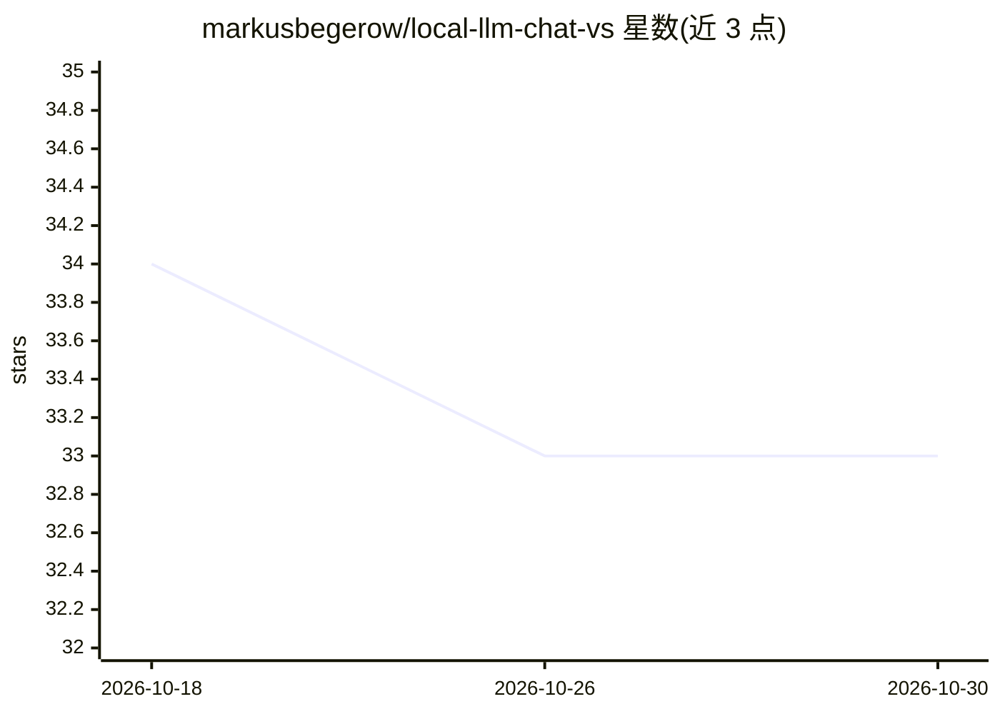

# markusbegerow/local-llm-chat-vs

⭐ 33 · C# · GPL-2.0 · 推送 2026-10-16 · [GitHub](https://github.com/markusbegerow/local-llm-chat-vs) · [官网](https://marketplace.visualstudio.com/items?itemName=MarkusBegerow.local-llm-chat-vs) · 个人维护

**Visual Studio 扩展：IDE 内与本地 LLM 私密聊天与编码辅助**

用 C# 编写的 Visual Studio 2022 扩展，在 IDE 工具窗口内提供与本地大模型的聊天界面，数据默认不离开本机。支持 Ollama、LM Studio、OpenAI 及任何 OpenAI 兼容端点；内置斜杠命令读取文件、列出目录、搜索与查看解决方案信息，AI 可通过 file 代码块建议生成文件（含确认提示与路径校验等安全机制）。要求 Visual Studio 2022（17.0+）与 .NET Framework 4.7.2+，通过 VSIX 文件安装或从源码构建。

## 筛选速览

| 维度 | 判定 | 备注 |
|---|---|---|
| AI 角色 | `ai-native` | 本体是模型或模型工具 |
| 许可风险 | `viral` | GPL-2.0 |
| 部署形态 | `desktop` | 安装包/桌面程序 |
| 模型依赖 | local-ok | 支持本地模型 |
| 硬件要求 | — | 无带数字的原话,不猜 |
| 安装摩擦 | `low` | 无编译、无系统依赖或容器化 |
| 成熟度 | — | 结构信号不足 |

## 能力要点

- IDE 内聊天窗口，默认全程本地、无外部 API 调用
- 兼容 Ollama/LM Studio/OpenAI 等 OpenAI 兼容端点
- 斜杠命令读取/搜索文件、查看解决方案信息作为对话上下文
- AI 生成文件带确认提示、路径校验与 1MB 大小限制

## 适用场景

- 在 Visual Studio 里用本地模型解释代码、分析项目结构
- 让 AI 生成 C# 服务类等完整文件并落到解决方案目录
- 不把代码发往云端的前提下做 AI 编码问答

## 场景标签

`AI 助手` `聊天机器人` `代码生成` · 领域:编码与开发

## 证据(README 行号)

> L9: **A powerful Visual Studio extension for chatting with local Large Language Models directly in your IDE—completely p
> L17: - **OpenAI-Compatible**: Works with Ollama, LM Studio, OpenAI, and any OpenAI-compatible endpoint
> L366: **Privacy Notice**: This extension operates entirely locally by default. No data is sent to external servers unles

## 星数曲线

2026-10-18 34 → 2026-10-30 33（-1）

---
*卡片 v1 · prompt 1.4 · 生成 2026-10-25 · 置信度 high · 依据 README sha `94dcc8f54ef4` · [字段定义](../../DATASET.md)*
