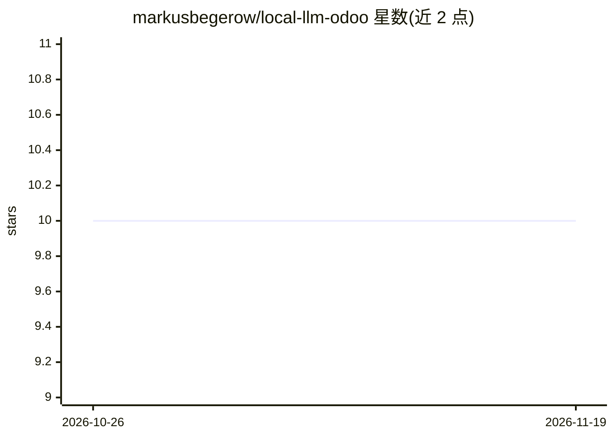

# markusbegerow/local-llm-odoo

⭐ 10 · Python · GPL-2.0 · 推送 2026-10-16 · [GitHub](https://github.com/markusbegerow/local-llm-odoo) · [官网](https://apps.odoo.com/apps/modules/18.0/local_llm_odoo) · 个人维护

**在 Odoo 18 中接入本地 LLM 的聊天模块**

一个 Odoo 18 模块，通过 Ollama、LM Studio、vLLM 或任意 OpenAI 兼容端点在 ERP 内提供对话式 AI 助手。数据全部保留在本地服务器，会话与消息存于 Odoo 数据库；提供系统级/用户级多配置、温度与 token 参数设置、连接测试。安全机制包括 Fernet(AES-128) API token 加密、CSRF 防护、每用户 20 请求/分钟限流、记录级访问控制与审计日志。安装需复制模块到 addons 目录并在 Apps 中激活。

## 筛选速览

| 维度 | 判定 | 备注 |
|---|---|---|
| AI 角色 | `ai-native` | 本体是模型或模型工具 |
| 许可风险 | `viral` | GPL-2.0 |
| 部署形态 | `library` | 以包/库形式分发 |
| 模型依赖 | local-ok | 支持本地模型 |
| 硬件要求 | — | 无带数字的原话,不猜 |
| 安装摩擦 | `low` | 无编译、无系统依赖或容器化 |
| 成熟度 | — | 结构信号不足 |

## 能力要点

- 支持 Ollama、LM Studio、vLLM 与任意 OpenAI 兼容端点
- API token 以 Fernet (AES-128) 加密存储，含 CSRF 防护与限流
- 会话与消息持久化在 Odoo 数据库，按用户隔离访问
- 默认每用户 20 请求/分钟的会话限流，可配置

## 适用场景

- 在 Odoo 内用本地模型生成产品描述和起草邮件
- 数据不出内网的客服/业务问答助手
- 为不同团队或用户配置不同的本地 LLM

## 场景标签

`AI 助手` `聊天机器人` · 领域:对话与助手

## 证据(README 行号)

> L3: A powerful Odoo 18 module that integrates local Large Language Models (LLMs) directly into your Odoo ERP system for 
> L11: - **Multiple LLM Support**: Works with Ollama, LM Studio, vLLM, and OpenAI-compatible endpoints
> L31: ### 💼 Business Use Cases

## 星数曲线

2026-10-26 10 → 2026-11-19 10（+0）

---
*卡片 v1 · prompt 1.4 · 生成 2026-11-19 · 置信度 mid · 依据 README sha `e9d41666bafc` · [字段定义](../../DATASET.md)*
