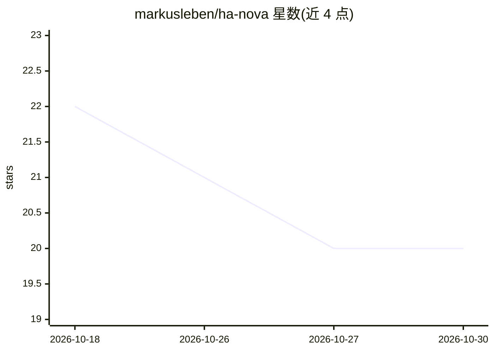

# markusleben/ha-nova

⭐ 20 · Go · MIT · 推送 2026-10-29 · [GitHub](https://github.com/markusleben/ha-nova) · [官网](https://hanova.app) · 个人维护

**让 Claude/ChatGPT 等 AI 应用安全操控 Home Assistant 的本地桥接层**

运行在用户电脑或 Home Assistant 上的桥接程序：把 Claude Code、Claude Desktop、Codex、OpenCode、ChatGPT 等连接到 Home Assistant，让用户以自然语言查询与操控智能家居。核心机制是分级安全：日常动作直接执行并事后校验，其余改动先出示前后对照预览，开锁/撤防/删除需电脑窗口、手机 Companion 应用或四位数字码确认；删除前保存副本，支持 revert 回滚。每台设备独立配对，Relay 登录凭据不进入 AI，本地模式无云端中转。提供一条命令的安装器与演示房屋体验。

## 筛选速览

| 维度 | 判定 | 备注 |
|---|---|---|
| AI 角色 | `ai-ecosystem` | LLM/agent 周边工具 |
| 许可风险 | `permissive` | MIT |
| 部署形态 | `desktop` | 安装包/桌面程序 |
| 模型依赖 | locked-api |  |
| 硬件要求 | — | 无带数字的原话,不猜 |
| 安装摩擦 | `low` | 无编译、无系统依赖或容器化 |
| 成熟度 | `idea` | |

## 能力要点

- 改动分级确认：日常动作直执行，开锁/撤防/删除需窗口/手机/数字码确认
- 删除与整体替换前自动保存副本，支持 revert 与按名恢复
- 按 40+ 规则检查自动化，可解释触发失败原因与设备配置
- 每设备独立配对，Relay 凭据对 AI 不可见，无云端中转与遥测

## 适用场景

- 用 Claude 或 ChatGPT 对话查询和操控家里的 Home Assistant 设备
- 让 AI 生成/修改自动化与仪表盘，并在保存前人工确认
- 排查自动化冲突、触发失败和传感器更换迁移

## 场景标签

`AI 助手` `工作流自动化` · 领域:效率与自动化

## 证据(README 行号)

> L11:  Connect your AI to Home Assistant. Simple things run right away. Other changes show a preview first. Unlocks, the 
> L15:  Works with Claude Code · Claude Desktop · Codex · OpenCode · Google Antigravity · Hermes Agent (preview)
> L16:  and in Claude (also on your phone) and ChatGPT on the web, on a computer, with the NOVA Relay App

## 星数曲线

2026-10-18 22 → 2026-10-30 20（-2）

---
*卡片 v1 · prompt 1.4 · 生成 2026-10-28 · 置信度 high · 依据 README sha `dd69e715a74b` · [字段定义](../../DATASET.md)*
