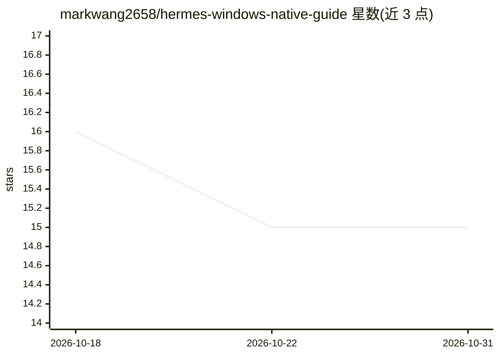

# markwang2658/hermes-windows-native-guide

⭐ 15 · MIT · 推送 2026-06-20 · [GitHub](https://github.com/markwang2658/hermes-windows-native-guide) · [官网](https://github.com/markwang2658/hermes-windows-native) · 个人维护

**已弃置仓库：Hermes Agent Windows 原生运行指南迁往新库**

一个已停止维护的迁移公告仓库：声明本仓库不再更新，全部内容（文档、安装指南、启动脚本、Hermes Agent 与 WebUI 集成、Windows 原生启动器文件）合并入 markwang2658/hermes-windows-native，本仓库仅作历史参考。内容围绕 NousResearch/hermes-agent 与 nesquena/hermes-webui 两个上游项目构建，定位为 Windows 原生（无 Docker、无 WSL2）运行 Agent 的指南。

## 筛选速览

| 维度 | 判定 | 备注 |
|---|---|---|
| AI 角色 | `ai-ecosystem` | LLM/agent 周边工具 |
| 许可风险 | `permissive` | MIT |
| 部署形态 | `None` |  |
| 模型依赖 | — | README 未给出锁定关系 |
| 硬件要求 | — | 无带数字的原话,不猜 |
| 安装摩擦 | `low` | 无编译、无系统依赖或容器化 |
| 成熟度 | — | 结构信号不足 |

## 能力要点

- 声明不再维护，内容合并入 markwang2658/hermes-windows-native
- 覆盖文档、安装指南、启动脚本与 Windows 原生启动器文件
- 围绕 NousResearch/hermes-agent 与 nesquena/hermes-webui 构建

## 适用场景

- 查找 Hermes Agent 在 Windows 原生环境运行的指南（应前往新仓库）
- 追溯 Windows 原生（无 Docker/WSL2）方案的整合历史

## 场景标签

`教程课程` · 领域:学习与行业

## 证据(README 行号)

> L5: This repository is no longer maintained.
> L29: - `hermes-agent`: NousResearch/hermes-agent

## 星数曲线

2026-10-18 16 → 2026-10-31 15（-1）

---
*卡片 v1 · prompt 1.4 · 生成 2026-10-30 · 置信度 mid · 依据 README sha `309ef8f6bdad` · [字段定义](../../DATASET.md)*
