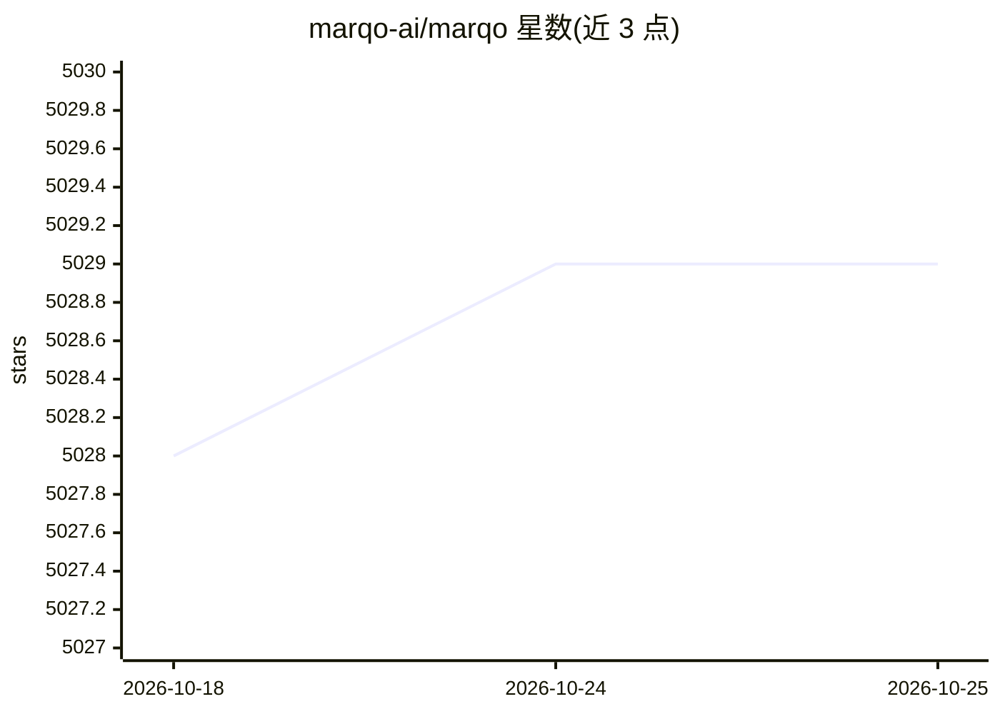

# marqo-ai/marqo

⭐ 5,029 · Python · Apache-2.0 · 推送 2026-09-03 · [GitHub](https://github.com/marqo-ai/marqo) · [官网](https://www.marqo.ai/) · 组织维护

**面向电商品牌的 AI 原生搜索与商品发现平台（开源版已停更）**

Marqo 是面向时尚、美妆、电子、家居等在线品牌的 AI 原生电商搜索平台，提供语义搜索与个性化能力，利用点击流、购买和事件数据理解购物者意图，输出个性化搜索结果与商品推荐；通过自动排序与优化减少人工运营投入。README 声明其开源项目已停止维护、不再更新，商业产品在 marqo.ai 提供。

## 筛选速览

| 维度 | 判定 | 备注 |
|---|---|---|
| AI 角色 | `ai-native` | 本体是模型或模型工具 |
| 许可风险 | `permissive` | Apache-2.0 |
| 部署形态 | `None` |  |
| 模型依赖 | — | README 未给出锁定关系 |
| 硬件要求 | — | 无带数字的原话,不猜 |
| 安装摩擦 | `low` | 无编译、无系统依赖或容器化 |
| 成熟度 | — | 结构信号不足 |

## 能力要点

- 语义搜索与个性化技术驱动电商搜索
- 利用点击流/购买/事件数据理解购物意图
- 提供个性化搜索结果与商品推荐
- 自动排序与优化减少人工商品运营工作

## 适用场景

- 电商站内搜索与商品推荐
- 基于购物行为数据做个性化排序
- 减少人工搜索运营与商品上架调优工作量

## 场景标签

`语义搜索` `推荐系统` · 领域:知识与检索

## 证据(README 行号)

> L5: Marqo is the an AI-native ecommerce search platform built for online brands in fashion, beauty, electronics, and hom
> L7: NOTICE: Marqo's Open Source project is deprecated and will no longer recieve updates. To explore Marqo's product sea

## 星数曲线

2026-10-18 5,028 → 2026-10-25 5,029（+1）

---
*卡片 v1 · prompt 1.4 · 生成 2026-10-20 · 置信度 mid · 依据 README sha `a630a402176b` · [字段定义](../../DATASET.md)*
