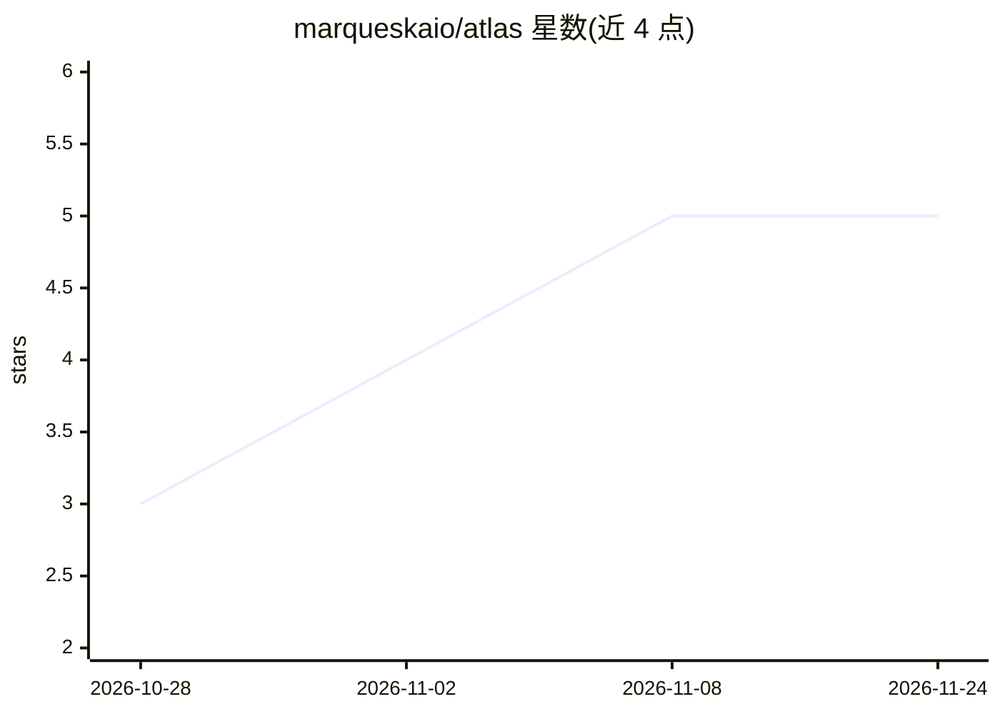

# marqueskaio/atlas

⭐ 5 · Python · MIT · 推送 2026-11-19 · [GitHub](https://github.com/marqueskaio/atlas) · 个人维护 · 中文 README

**管理多个编码代理账户与机器的个人代理桌面应用**

开源个人代理，带桌面应用与后台服务。核心机制：把 Claude Code、Codex、Gemini CLI、DeepSeek 作为执行器统一管理——多账户并行、会话中断续传、计划限额自动切换、跨执行器 handoff；同时自身提供可读文本记忆、自写技能、定时任务、Telegram 接入、审批门与加密保管库。安装脚本自带 Python/Node，数据存于本地 ATLAS_HOME 文件夹。README 自述处于早期阶段，版本间可能有变化。

## 筛选速览

| 维度 | 判定 | 备注 |
|---|---|---|
| AI 角色 | `ai-ecosystem` | LLM/agent 周边工具 |
| 许可风险 | `permissive` | MIT |
| 部署形态 | `None` |  |
| 模型依赖 | local-ok | 支持本地模型 |
| 硬件要求 | — | 无带数字的原话,不猜 |
| 安装摩擦 | `low` | 无编译、无系统依赖或容器化 |
| 成熟度 | `idea` | |

## 能力要点

- 多账户与会话路由：限额自动切换、跨执行器 handoff（无模型调用拼装上下文）
- 明文记忆与自写技能：可读、可编辑、可回滚（atlas skills revert）
- 审批门与加密保管库，敏感操作始终先询问
- 多机接入：Tailscale 或 SSH 连接远程机器，服务随系统启动

## 适用场景

- 在同一应用里管理个人与公司多个 Claude Code/Codex 账户
- 额度用尽后让会话自动切到下一账户或执行器
- 把代理部署在家庭服务器/VPS 上，从笔记本远程操作
- 通过 Telegram 在手机上接续会话与审批

## 场景标签

`编码 Agent` `AI 助手` · 领域:编码与开发

## 证据(README 行号)

> L5:  Your personal agent, and one app for every coding agent you use:
> L19: And it is where your coding agents live. Run Claude Code on your personal account and Codex on your
> L26: Claude Code, Codex, the Gemini CLI and DeepSeek's harness are **executors**: Atlas runs the copy you

## 星数曲线

2026-10-28 3 → 2026-11-24 5（+2）

---
*卡片 v1 · prompt 1.4 · 生成 2026-11-21 · 置信度 high · 依据 README sha `1f67b1f315ce` · [字段定义](../../DATASET.md)*
