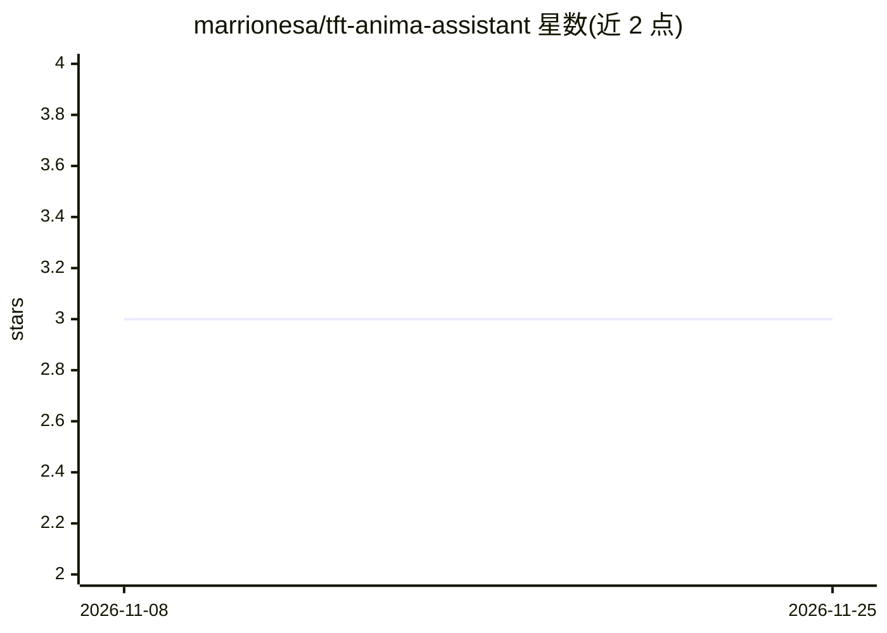

# marrionesa/tft-anima-assistant

⭐ 3 · C · MIT · 推送 2026-11-10 · [GitHub](https://github.com/marrionesa/tft-anima-assistant) · 个人维护

**本地自托管的西语语音/聊天个人助手，配 ESP8266 TFT 硬件屏幕**

ANIMA 是一个完全运行在用户本地网络的个人语音与聊天助手，以西班牙语交互：Ollama 在本机提供 LLM，faster-whisper 做语音转写，Piper 做语音合成，浏览器端为可安装的 PWA，另通过 NodeMCU ESP8266 驱动 ST7735 TFT 屏幕实时显示状态与回答。仓库为 monorepo，含 FastAPI Chat API、Voice API 与统一启动器三个组件，ASR/LLM 仅监听 loopback，无遥测。限制：默认仅假定可信家庭网络、无认证，Chat API 用锁串行化请求，一次只处理一个请求。

## 筛选速览

| 维度 | 判定 | 备注 |
|---|---|---|
| AI 角色 | `ai-native` | 本体是模型或模型工具 |
| 许可风险 | `permissive` | MIT |
| 部署形态 | `library` | 以包/库形式分发 |
| 模型依赖 | local-ok | 支持本地模型 |
| 硬件要求 | — | 无带数字的原话,不猜 |
| 安装摩擦 | `low` | 无编译、无系统依赖或容器化 |
| 成熟度 | `idea` | |

## 能力要点

- 语音对话全本地：faster-whisper 转写 + Piper 合成，支持静默检测轮次与随时打断
- Ollama 本地运行 LLM（默认 qwen2.5-coder:14b，.env 可更换模型）
- NodeMCU ESP8266 + ST7735 TFT 作为物理机身，WebSocket 实时显示状态
- PWA 可安装到手机主屏，ASR/LLM 仅监听 127.0.0.1，无遥测

## 适用场景

- 在家庭网络中搭建不依赖云服务的私人语音助手
- 给桌面配一块 TFT 屏幕实时显示助手思考与回答
- 用手机浏览器与本地 LLM 进行私密对话

## 场景标签

`AI 助手` `语音 Agent` · 领域:对话与助手

## 证据(README 行号)

> L12: **ANIMA** es un asistente personal que habla y escucha en español, y que además tiene cuerpo: una pantalla TFT físi
> L52: |`anima-voice-server/`|Motor de voz local: Whisper para transcribir, Piper para hablar|`uvicorn voice_service:app -
> L192: |LLM|Ollama (`qwen2.5-coder:14b` por defecto)|

## 星数曲线

2026-11-08 3 → 2026-11-25 3（+0）

---
*卡片 v1 · prompt 1.4 · 生成 2026-11-21 · 置信度 high · 依据 README sha `ead0ed095fc3` · [字段定义](../../DATASET.md)*
