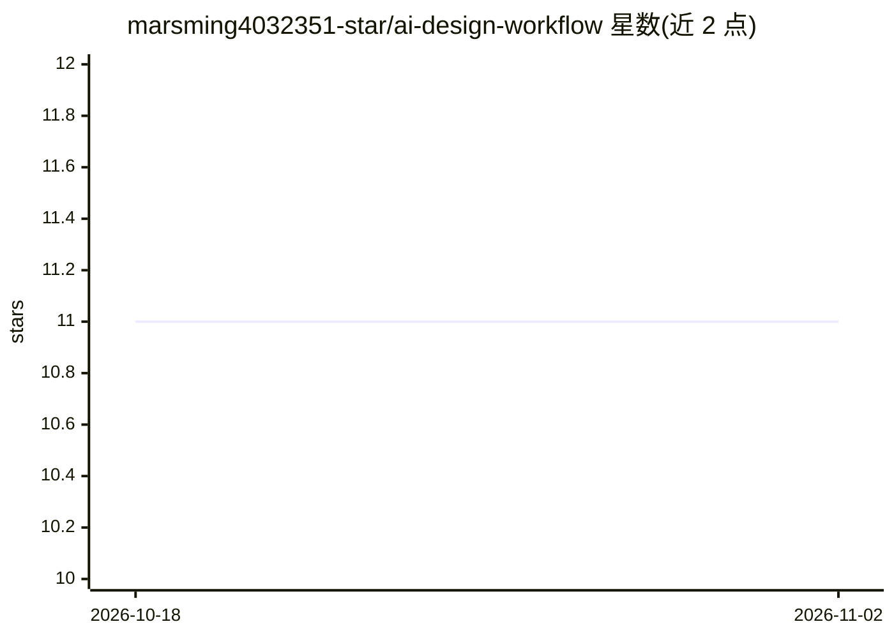

# marsming4032351-star/ai-design-workflow

⭐ 11 · Python · MIT · 推送 2026-02-08 · [GitHub](https://github.com/marsming4032351-star/ai-design-workflow) · 个人维护 · 中文 README

**面向室内设计师的 6 智能体提示词工作流技能库**

由 6 个提示词驱动的“AI 智能体专家”（项目分析、彩平绘制、3D 建模、风格渲染、摄影优化、软装排版）组成的室内设计工作流系统，每个智能体基于一种提示词框架（BROKE/COSTAR/RTGO/CARE/RTF/ROSES）。本体是一套 Skills 与文档，需配合外部 AI 对话系统（如 Claude、ChatGPT）使用，不含代码运行时；仅 knowledge-librarian.py 为辅助索引脚本。另含 TRACE 案例学习框架，将设计案例提取为约 2KB 的文本参数卡片供后续引用。用户无需编程基础。

## 筛选速览

| 维度 | 判定 | 备注 |
|---|---|---|
| AI 角色 | `ai-knowledge` | 知识聚合/清单类 |
| 许可风险 | `permissive` | MIT |
| 部署形态 | `None` |  |
| 模型依赖 | — | README 未给出锁定关系 |
| 硬件要求 | — | 无带数字的原话,不猜 |
| 安装摩擦 | `low` | 无编译、无系统依赖或容器化 |
| 成熟度 | — | 结构信号不足 |

## 能力要点

- 6 个职能独立的提示词智能体，分别绑定一种提示词框架
- TRACE 框架从设计案例提取量化参数（材质/色值/灯光）存为知识卡片
- knowledge-librarian 脚本自动汇总案例并更新智能体记忆
- 工作流覆盖项目分析到方案册与物料清单交付

## 适用场景

- 室内设计师借助 AI 对话工具完成从 CAD 图纸到方案册的完整流程
- 通过案例链接学习特定风格（如当代东方）并应用到新项目
- 仅需单一环节能力（如彩平图或杂志级渲染）时单独调用对应智能体

## 场景标签

`提示工程` · 领域:Agent 开发

## 证据(README 行号)

> L5: 一个基于 AI 智能体的模块化设计工作流系统,通过 6 个专业智能体实现从项目分析到最终交付的完整设计流程。
> L264: - AI 对话系统(如 Claude、ChatGPT 等)

## 星数曲线

2026-10-18 11 → 2026-11-02 11（+0）

---
*卡片 v1 · prompt 1.4 · 生成 2026-11-02 · 置信度 mid · 依据 README sha `3703b6739932` · [字段定义](../../DATASET.md)*
