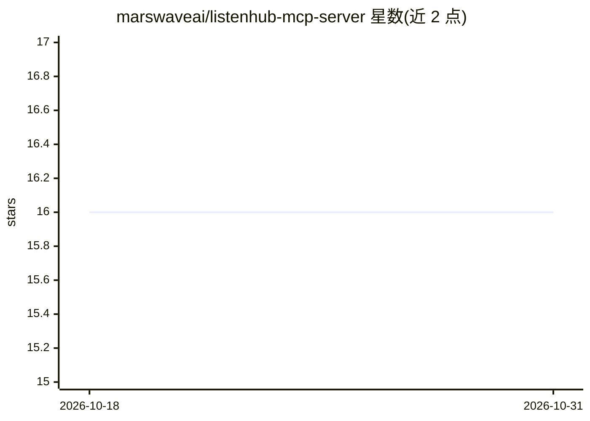

# marswaveai/listenhub-mcp-server

⭐ 16 · TypeScript · Apache-2.0 · 推送 2026-09-17 · [GitHub](https://github.com/marswaveai/listenhub-mcp-server) · [官网](https://listenhub.ai) · 组织维护 · 中文 README

**ListenHub 官方 MCP 服务器：让 AI 客户端生成播客与语音**

Marswave 官方维护的 MCP Server，把 ListenHub 的 AI 播客生成（1-2 说话人、quick/deep/debate 三种模式、支持文本或 URL 来源、两阶段生成）与 FlowSpeech 语音生成（Smart/Direct 模式）暴露为 MCP 工具，另含音色库查询与订阅/积分查询。以 npx 方式运行，支持 Stdio、HTTP SSE、HTTP Streamable 三种传输；提供 Claude Desktop、Cursor、Windsurf、VS Code(Cline)、Zed、Claude CLI、Codex CLI、ChatWise 等客户端配置说明。需 Node.js 18+ 与 ListenHub API Key，功能面向 Pro 套餐及以上用户。

## 筛选速览

| 维度 | 判定 | 备注 |
|---|---|---|
| AI 角色 | `ai-ecosystem` | LLM/agent 周边工具 |
| 许可风险 | `permissive` | Apache-2.0 |
| 部署形态 | `desktop` | 安装包/桌面程序 |
| 模型依赖 | — | README 未给出锁定关系 |
| 硬件要求 | — | 无带数字的原话,不猜 |
| 安装摩擦 | `low` | 无编译、无系统依赖或容器化 |
| 成熟度 | — | 结构信号不足 |

## 能力要点

- 播客生成支持 1-2 说话人、quick/deep/debate 模式与两阶段生成
- FlowSpeech 文本/URL 转单说话人语音（Smart/Direct 模式）
- 支持 Stdio、HTTP SSE、HTTP Streamable 三种传输模式
- 覆盖 8 类 MCP 客户端的配置说明

## 适用场景

- 在 Claude Desktop 或 Cursor 等客户端里直接生成播客音频
- 把文章 URL 转成 FlowSpeech 语音内容
- 查询音色库与账户订阅、积分消耗情况

## 场景标签

`语音合成` · 领域:内容生成

## 证据(README 行号)

> L3: Official MCP Server for ListenHub, supporting AI podcast generation (single or dual-speaker), FlowSpeech creation, a
> L244: - **Multiple Transport Modes**: Support for Stdio, HTTP SSE, and HTTP Streamable transport methods for flexible in

## 星数曲线

2026-10-18 16 → 2026-10-31 16（+0）

---
*卡片 v1 · prompt 1.4 · 生成 2026-10-30 · 置信度 high · 依据 README sha `633f69d1613f` · [字段定义](../../DATASET.md)*
