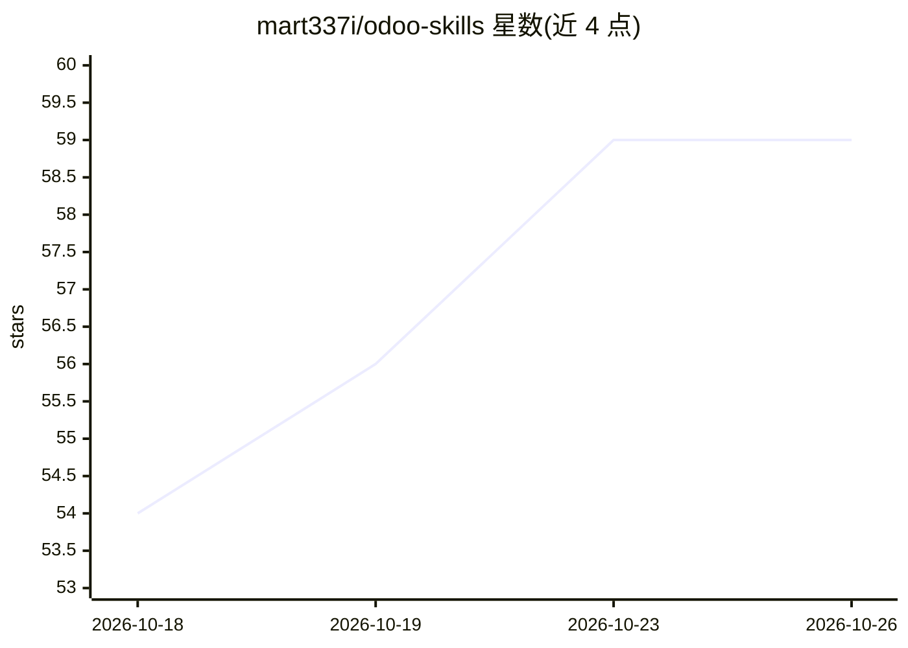

# mart337i/odoo-skills

⭐ 59 · JavaScript · 推送 2026-10-01 · [GitHub](https://github.com/mart337i/odoo-skills) · 个人维护

**面向 AI 编码 agent 的 Odoo 开发技能包（21 个技能）**

为 AI 编码 agent（Claude、OpenCode 等）提供的技能包，覆盖 Odoo 插件开发、OWL 前端、QWeb 报表设计与迁移、OCA 模块迁移（8.0–20.0）、代码审查、执行追踪、测试编写与 Web 安全检查等，附版本专属参考（Odoo 17–20）与通用计划拷问、架构审查工作流。技能约束 agent 行为：先检测版本、读取 manifest/安全配置、在触库命令前询问。通过 npx 安装器复制技能到 agent 技能目录，或 git clone 后软链接。不覆盖 OpenUpgrade 流程。

## 筛选速览

| 维度 | 判定 | 备注 |
|---|---|---|
| AI 角色 | `ai-ecosystem` | LLM/agent 周边工具 |
| 许可风险 | `none` | — |
| 部署形态 | `library` | 以包/库形式分发 |
| 模型依赖 | locked-api |  |
| 硬件要求 | — | 无带数字的原话,不猜 |
| 安装摩擦 | `low` | 无编译、无系统依赖或容器化 |
| 成熟度 | — | 结构信号不足 |

## 能力要点

- 21 个技能：开发、迁移、代码审查、执行追踪、测试、安全、报表
- OCA 模块迁移覆盖 Odoo 8.0 至 20.0，版本参考覆盖 17–20
- 约束 agent 在数据库相关命令前询问并检查 sudo/ACL/多公司隔离
- npx 安装器支持按 target 安装到 Claude 或 OpenCode

## 适用场景

- 让 AI 编码 agent 按 Odoo 版本专属 API 与约定开发插件
- 准备 OCA 模块跨版本迁移的 [MIG] PR
- 审查 Odoo 代码的安全、正确性与测试覆盖

## 场景标签

`代码审查` `提示工程` · 领域:Agent 开发

## 证据(README 行号)

> L18: **Odoo Skills** is an Odoo-focused skill pack with a small set of generic engineering workflows for AI coding agent
> L22: This repo gives your agent a practical operating manual: what to inspect, what to ask, what not to run without conf
> L57: The installer copies all skills into both `~/.claude/skills` and `~/.config/opencode/skills` by default. Existing s

## 星数曲线

2026-10-18 54 → 2026-10-26 59（+5）

---
*卡片 v1 · prompt 1.4 · 生成 2026-10-24 · 置信度 high · 依据 README sha `b513a5f84244` · [字段定义](../../DATASET.md)*
