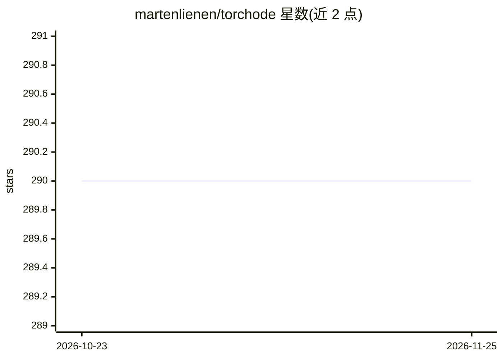

# martenlienen/torchode

⭐ 290 · Python · MIT · 推送 2026-11-17 · [GitHub](https://github.com/martenlienen/torchode) · [官网](https://torchode.readthedocs.io) · 个人维护

**为 PyTorch 提供批内并行的 ODE 求解器库**

torchode 提供一组单步 ODE 求解器（如 dopri5、tsit5），兼容 torch.compile，并沿 batch 维度并行执行：每个样本可按自身难度采用不同步长，避免刚性差异导致的性能问题，并使预测与 batch 组成无关。以 pip 包发布，提供文档、使用示例与 GitHub issue 渠道，附学术论文引用条目。依赖 PyTorch 生态，属于科学计算/深度学习基础库。

## 筛选速览

| 维度 | 判定 | 备注 |
|---|---|---|
| AI 角色 | `ai-native` | 本体是模型或模型工具 |
| 许可风险 | `permissive` | MIT |
| 部署形态 | `library` | 以包/库形式分发 |
| 模型依赖 | — | README 未给出锁定关系 |
| 硬件要求 | — | 无带数字的原话,不猜 |
| 安装摩擦 | `low` | 无编译、无系统依赖或容器化 |
| 成熟度 | — | 结构信号不足 |

## 能力要点

- 提供 dopri5、tsit5 等单步 ODE 求解器
- 兼容 torch.compile，可编译提升性能
- batch 内并行，各样本可使用不同自适应步长
- 提供文档与 PyPI 安装包

## 适用场景

- 训练含 Neural ODE 分支的深度学习模型
- 在 PyTorch 中对不同刚性的 batch 样本并行积分
- 需要预测结果与 batch 组成无关的建模任务

## 场景标签

 · 领域:深度学习/科学计算库

## 证据(README 行号)

> L5: torchode is a suite of single-step ODE solvers such as `dopri5` or `tsit5` that are
> L6: compatible with PyTorch's JIT compiler `torch.compile` and parallelized across a batch.

## 星数曲线

2026-10-23 290 → 2026-11-25 290（+0）

---
*卡片 v1 · prompt 1.4 · 生成 2026-11-25 · 置信度 high · 依据 README sha `dfb2d4bb6ca9` · [字段定义](../../DATASET.md)*
