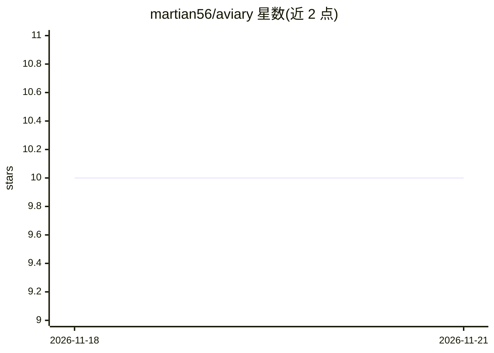

# martian56/aviary

⭐ 10 · Rust · MIT · 推送 2026-11-20 · [GitHub](https://github.com/martian56/aviary) · 个人维护

**为 Raven 语言提供统一多家 LLM 服务的 chat-completion 客户端库**

面向 Raven 语言的 LLM 客户端库：以 provider/model 形式的模型字符串选择端点、凭据与线格式，同一份代码可跨服务商运行。提供 complete/ask/complete_stream 接口，支持流式输出、每请求超时、取消令牌、指数退避重试与 tool calling；.cache(true) 标记可缓存前缀（当前仅 Anthropic 适配器生效）。通过 rvpm 安装，纯 Raven 实现，无原生依赖，需 Raven 2.21.0 及以上工具链。

## 筛选速览

| 维度 | 判定 | 备注 |
|---|---|---|
| AI 角色 | `ai-ecosystem` | LLM/agent 周边工具 |
| 许可风险 | `permissive` | MIT |
| 部署形态 | `None` |  |
| 模型依赖 | local-ok | 支持本地模型 |
| 硬件要求 | — | 无带数字的原话,不猜 |
| 安装摩擦 | `low` | 无编译、无系统依赖或容器化 |
| 成熟度 | — | 结构信号不足 |

## 能力要点

- 一个 chat-completion API 覆盖约 20 个 provider，改一个模型字符串即可切换
- 流式输出、每请求超时与 CancelToken 中途取消（保留已生成部分回复）
- 429/5xx/传输错误的指数退避重试，流开始后不再重试以免重复输出
- 支持 tool calling 与 prompt caching（Anthropic 适配器添加 cache_control）

## 适用场景

- Raven 项目中接入多家 LLM 服务而不改动业务代码
- 通过 custom provider 接入任意 OpenAI 兼容服务或自建网关
- 构建需要流式输出与工具调用的对话/Agent 应用

## 场景标签

`模型网关` · 领域:Agent 开发

## 证据(README 行号)

> L5: One chat-completion API across many LLM providers, for
> L7: neutral request and reply; switch providers by changing the model string.
> L42: Every request names its model as `provider/model`. The provider before the

## 星数曲线

2026-11-18 10 → 2026-11-21 10（+0）

---
*卡片 v1 · prompt 1.4 · 生成 2026-11-19 · 置信度 high · 依据 README sha `ed058307a60e` · [字段定义](../../DATASET.md)*
