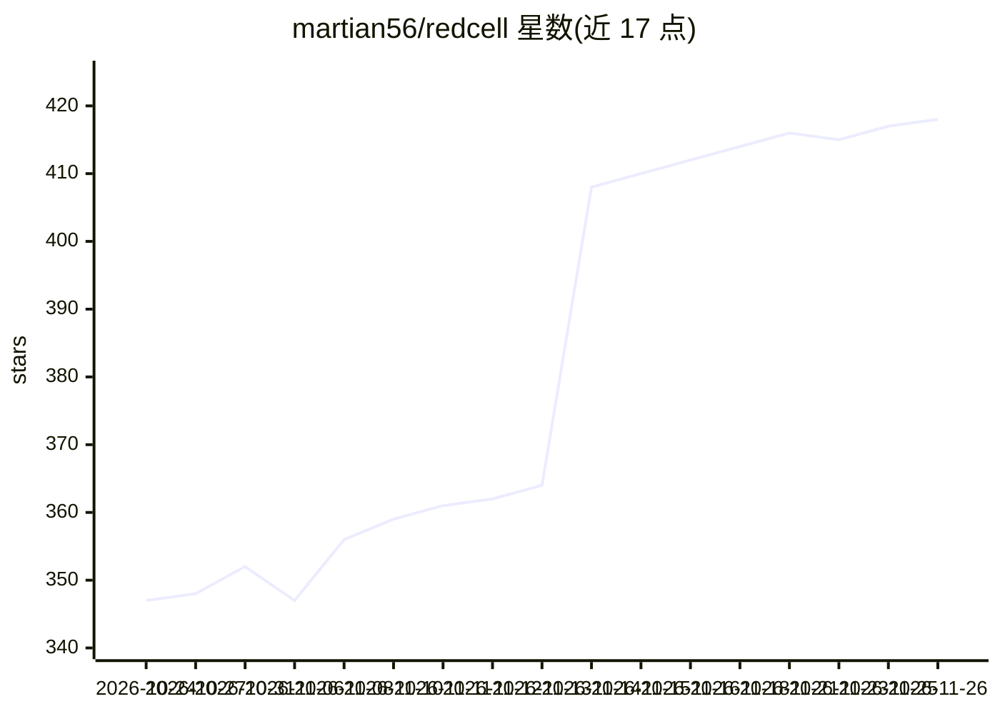

# martian56/redcell

⭐ 418 · Python · MIT · 推送 2026-11-18 · [GitHub](https://github.com/martian56/redcell) · 个人维护

**授权安全测试者的多 Agent 自动渗透测试平台**

以 LLM Agent 团队执行端到端渗透测试并生成报告的平台：编排器经 LangGraph plan/act 循环分配目标给执行器 Agent，在 Kali 容器内运行 nmap、nuclei、Metasploit 等工具并记录发现；提供操作员控制台，含聊天驱动、实时 Agent 图、Agent 浏览器与反向 shell 终端。模型经 LiteLLM 可插拔，支持 OpenAI/Anthropic/Ollama 等。支持会话检查点、PDF/JSON/SARIF 报告导出。仅限教育、研究与合法授权测试。

## 筛选速览

| 维度 | 判定 | 备注 |
|---|---|---|
| AI 角色 | `ai-native` | 本体是模型或模型工具 |
| 许可风险 | `permissive` | MIT |
| 部署形态 | `self-host` | docker 或自建部署 |
| 模型依赖 | local-ok | 支持本地模型 |
| 硬件要求 | — | 无带数字的原话,不猜 |
| 安装摩擦 | `low` | 无编译、无系统依赖或容器化 |
| 成熟度 | — | 结构信号不足 |

## 能力要点

- LangGraph plan/act 多 Agent 引擎，编排器委派执行器在 Kali 容器内运行真实工具
- 模型经 LiteLLM 可插拔，支持 OpenAI/Anthropic/DeepSeek/Ollama 等
- Agent 捕获反向 shell 并提供交互终端，支持经 shell 的网络跳板
- 报告导出 PDF/JSON/SARIF，由模型生成并按优先级整理

## 适用场景

- 对自己拥有或获书面授权的系统运行自动化渗透测试
- 对 DVWA/Juice Shop 等本地漏洞靶场进行练习
- 对公开 git 仓库或本地目录做源码安全审查

## 场景标签

`网络安全` `多智能体` `代码审查` · 领域:Agent 开发

## 证据(README 行号)

> L26: REDCELL runs a team of LLM agents through a pentest. An orchestrator plans the engagement and hands objectives to e
> L28: Models are pluggable through LiteLLM, so you can point it at OpenAI, Anthropic, Google, GLM, DeepSeek, Kimi, a loca
> L32: - **Multi-agent engine.** A LangGraph plan/act loop. The orchestrator delegates objectives to executor agents that 

## 星数曲线

2026-10-24 347 → 2026-11-26 418（+71）

---
*卡片 v1 · prompt 1.4 · 生成 2026-11-25 · 置信度 high · 依据 README sha `051c3f8937b2` · [字段定义](../../DATASET.md)*
