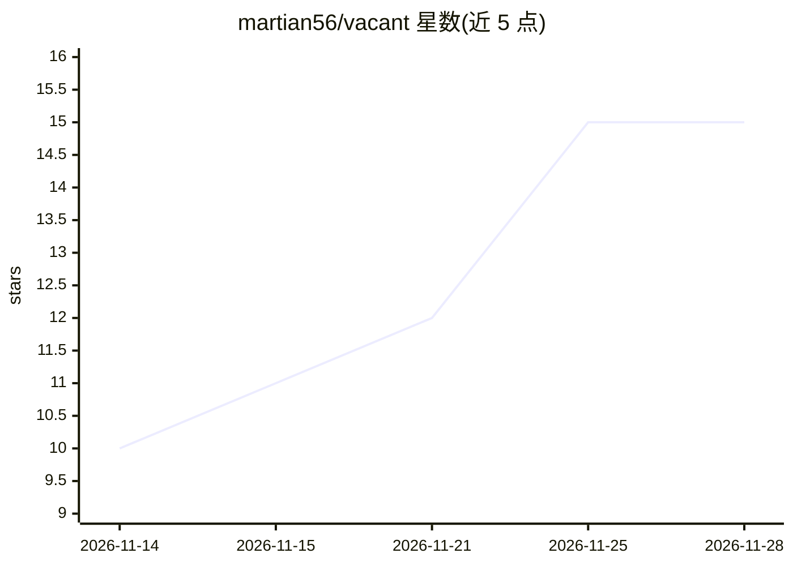

# martian56/vacant

⭐ 15 · TypeScript · MIT · 推送 2026-06-19 · [GitHub](https://github.com/martian56/vacant) · 个人维护

**自托管 AI 域名查找器：只显示可注册域名**

Vacant 是一个可自托管的开源域名查找工具。用户用自然语言描述品牌，AI 生成候选名称，或用模式（槽位/字面后缀）拼出名称形状；每个候选经 RDAP→DNS→WHOIS→Domainr 的级联查询核实注册可用性后才展示，附价格估算与注册商链接，结果流式返回并带共享缓存与并发限制。需 Bun 运行或用容器部署，必填 OpenRouter API key，可用 Docker/Compose 运行。

## 筛选速览

| 维度 | 判定 | 备注 |
|---|---|---|
| AI 角色 | `ai-native` | 本体是模型或模型工具 |
| 许可风险 | `permissive` | MIT |
| 部署形态 | `self-host` | docker 或自建部署 |
| 模型依赖 | locked-api |  |
| 硬件要求 | — | 无带数字的原话,不猜 |
| 安装摩擦 | `low` | 无编译、无系统依赖或容器化 |
| 成熟度 | `idea` | |

## 能力要点

- AI 生成品牌名 + 模式槽位（如 (animals)、(com/io)）两种搜索方式
- 可用性经 RDAP→DNS→WHOIS（可选 Domainr）级联核实，仅展示可注册域名
- 无 key 价格估算接口与按长度/可读性排序
- Bun 一条命令或预构建容器自托管，收藏与历史存于本地浏览器

## 适用场景

- 为新品牌批量寻找可注册的域名
- 用模式约束名称形状（固定前后缀、指定后缀）
- 团队内部自建域名可用性检查工具

## 场景标签

`AI 写作` · 领域:内容生成

## 证据(README 行号)

> L3: **Describe the brand you want. Vacant suggests names with AI and shows only the domains you can actually register.**
> L9: Vacant is a free, open-source, self-hostable domain finder. Clone it and run it, or pull the prebuilt container. Not
> L36: - **Plain words**: `a calm fintech brand, short and warm`. The AI proposes brandable names.

## 星数曲线

2026-11-14 10 → 2026-11-28 15（+5）

---
*卡片 v1 · prompt 1.4 · 生成 2026-11-18 · 置信度 high · 依据 README sha `c9070186cf0e` · [字段定义](../../DATASET.md)*
