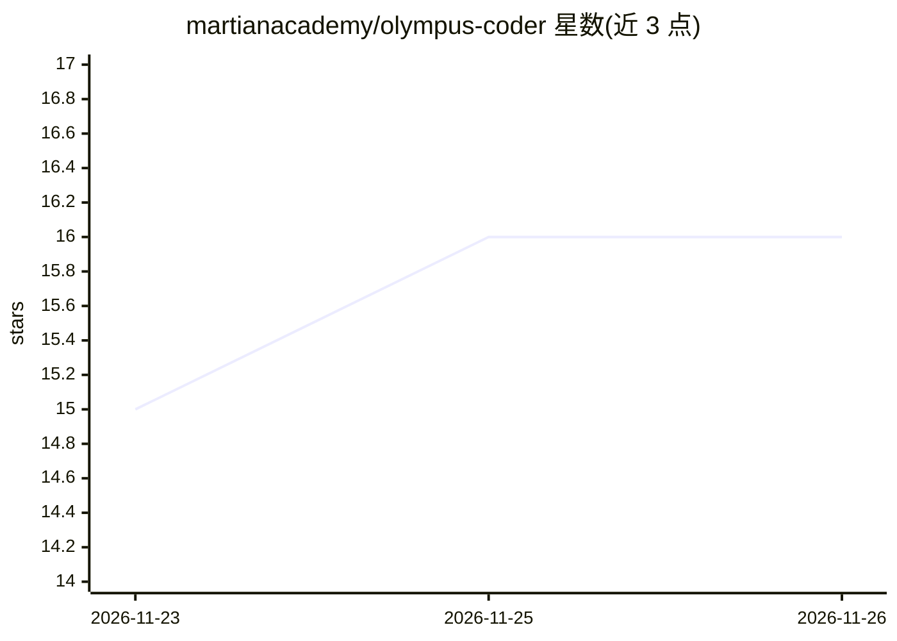

# martianacademy/olympus-coder

⭐ 16 · TypeScript · Apache-2.0 · 推送 2026-11-25 · [GitHub](https://github.com/martianacademy/olympus-coder) · [官网](https://olympus.marsnext.in) · 组织维护

**统一桌面工作台：在一个应用里管理所有 ACP 编码 agent**

基于 Electron 的桌面与 VPS 应用，通过 ACP 协议接入 Claude Code、Codex、Antigravity 等 20 个内置 CLI 及 ACP Registry 的 46+ agent。核心机制包括：跨 agent 共享的 ~/.olympus 记忆目录（MEMORY.md/INSTRUCTIONS.md 等）、线程中途切换 agent 的会话迁移、内置 MCP 编排服务器支持并行子会话，以及 AES-256-GCM 端到端加密的手机/浏览器远程访问。支持 macOS 安装包与 Homebrew，提供零 Electron 的 headless Linux 服务器模式；Windows/Linux 桌面安装包标注 coming soon。许可证为 Apache-2.0。

## 筛选速览

| 维度 | 判定 | 备注 |
|---|---|---|
| AI 角色 | `ai-ecosystem` | LLM/agent 周边工具 |
| 许可风险 | `permissive` | Apache-2.0 |
| 部署形态 | `desktop` | 安装包/桌面程序 |
| 模型依赖 | local-ok | 支持本地模型 |
| 硬件要求 | — | 无带数字的原话,不猜 |
| 安装摩擦 | `medium` | 含编译或系统依赖之一 |
| 成熟度 | `idea` | |

## 能力要点

- 20 个内置 ACP agent CLI 与 ACP Registry 46+ agent 接入，线程中途切换共享记忆
- 两级持久记忆 ~/.olympus 取代各厂商独立目录（~/.claude、~/.codex 等）
- 内置 MCP 编排服务器：spawn_subsession 并行子会话、配额限额时切换模型
- AES-256-GCM E2EE Cloudflare Relay 手机访问与零知识中继

## 适用场景

- 在一个应用里安装、登录并轮换使用多个编码 agent
- 让不同 agent 在同一会话中接力并保留项目上下文
- 在 VPS 上跑 headless 服务，用手机远程控制编码会话
- 用并行子会话同时推进多个编码任务

## 场景标签

`编码 Agent` `多智能体` · 领域:Agent 开发

## 证据(README 行号)

> L3:  One native workspace for every ACP coding agent — shared <code>~/.olympus</code> memory, parallel orchestration, bu
> L44: Install, authenticate, and rotate across **Claude Code**, **18 free-tier coding CLIs**, and **Local Ollama** right 
> L104: - **Built-in `olympus` MCP server:** Lead agents can spawn parallel sub-sessions (`spawn_subsession`), steer or sw

## 星数曲线

2026-11-23 15 → 2026-11-26 16（+1）

---
*卡片 v1 · prompt 1.4 · 生成 2026-11-23 · 置信度 high · 依据 README sha `2eaa8981cffd` · [字段定义](../../DATASET.md)*
