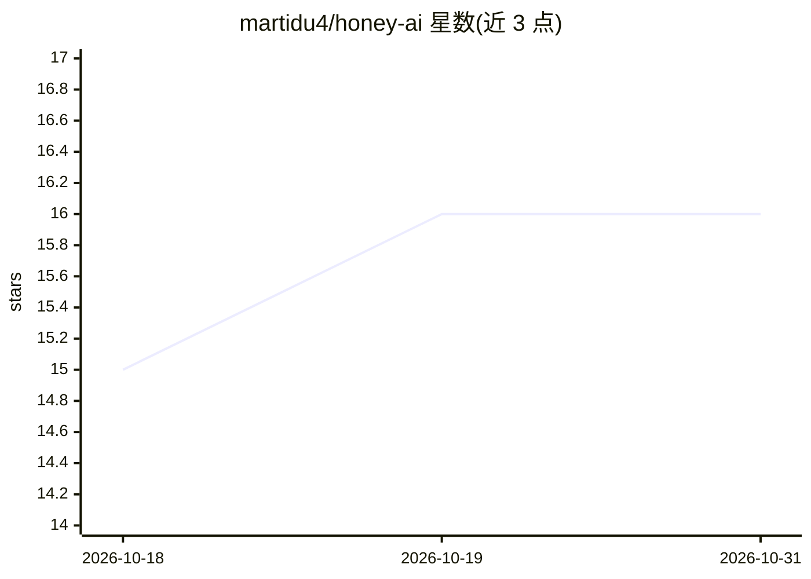

# martidu4/honey-ai

⭐ 16 · JavaScript · AGPL-3.0 · 推送 2026-10-05 · [GitHub](https://github.com/martidu4/honey-ai) · 个人维护

**本地 LLM 驱动的多协议蜜罐，欺骗攻击者并上报威胁情报**

单一 Node.js 进程提供 17 种协议蜜罐（SSH/HTTP/FTP/Telnet/SMTP/MySQL/Redis/Git/VNC/RDP 等），通过 Ollama 本地运行 LLM（或任意 OpenAI 兼容 API）读取攻击者载荷并生成定制欺骗内容：假数据库转储、交互式假 bash shell、假敏感文件等；内置蜜罐文件系统的 canary token、GZIP 炸弹、tarpit 重定向，并自动向 AbuseIPDB、OTX 等 5+ 威胁情报平台报告攻击 IP。带本地管理面板、Telegram 通知与按 IP 的 AI 调用节流。README 自称替代 Cowrie/Galah/OpenCanary/Endlessh。给安全研究人员与蓝队使用；要求 Node.js ≥18 与 pnpm（npm/yarn 被刻意阻断）。

## 筛选速览

| 维度 | 判定 | 备注 |
|---|---|---|
| AI 角色 | `ai-native` | 本体是模型或模型工具 |
| 许可风险 | `viral` | AGPL-3.0 |
| 部署形态 | `self-host` | docker 或自建部署 |
| 模型依赖 | local-ok | 支持本地模型 |
| 硬件要求 | — | 无带数字的原话,不猜 |
| 安装摩擦 | `low` | 无编译、无系统依赖或容器化 |
| 成熟度 | — | 结构信号不足 |

## 能力要点

- 17 种协议蜜罐汇聚于单一 Node.js 进程
- LLM 读取攻击载荷并生成定制的欺骗性响应（假 shell/假凭据/假目录）
- 攻击 IP 自动上报至 AbuseIPDB/OTX/DShield/Blocklist.de/VirusTotal 等平台
- 按 IP 会话预算的 Smart Throttle 与并发门控防止 CPU 被滥用

## 适用场景

- 部署诱捕 SSH/Web 等服务的蜜罐，观察并记录攻击者行为
- 通过 canary token 检测凭据窃取并收到 Telegram 告警
- 向威胁情报平台自动上报恶意 IP

## 场景标签

`网络安全` · 领域:学习与行业

## 证据(README 行号)

> L18: HoneyAI is a **proactive, AI-driven honeypot** that intercepts attackers across every common protocol and responds 
> L56: |🤖 **Any LLM**|Works with Ollama (local) or any OpenAI-compatible API|

## 星数曲线

2026-10-18 15 → 2026-10-31 16（+1）

---
*卡片 v1 · prompt 1.4 · 生成 2026-10-30 · 置信度 mid · 依据 README sha `2a9084cb48cc` · [字段定义](../../DATASET.md)*
