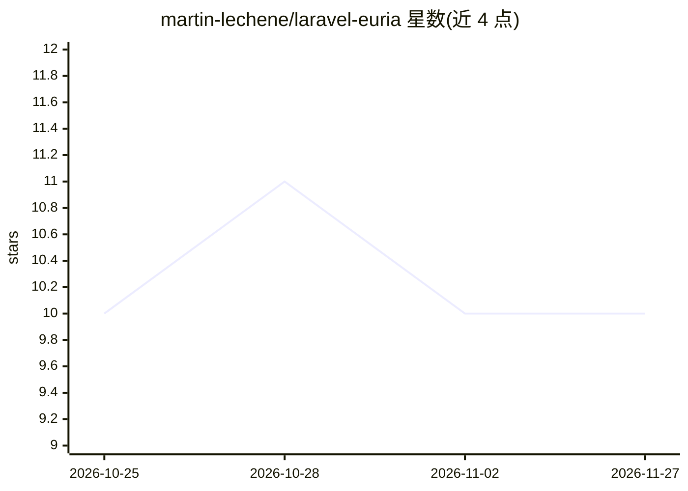

# martin-lechene/laravel-euria

⭐ 10 · PHP · MIT · 推送 2026-11-03 · [GitHub](https://github.com/martin-lechene/laravel-euria) · [官网](https://euria.infomaniak.com/) · 个人维护

**在 Laravel 中接入 Infomaniak Euria AI API 的封装包**

面向 Laravel 开发者的 PHP 包，封装 Infomaniak 托管于瑞士的 Euria AI 服务 API。通过 Composer 安装，发布配置后在 `.env` 填入 OAuth2 API Token 与默认模型即可使用；提供 Facade 调用、Agent 契约接口（含 Promptable trait）、用于离线测试的 EuriaFake，以及连接测试、模型列表、Agent 脚手架生成三个 Artisan 命令。MIT 许可。

## 筛选速览

| 维度 | 判定 | 备注 |
|---|---|---|
| AI 角色 | `ai-ecosystem` | LLM/agent 周边工具 |
| 许可风险 | `permissive` | MIT |
| 部署形态 | `None` |  |
| 模型依赖 | — | README 未给出锁定关系 |
| 硬件要求 | — | 无带数字的原话,不猜 |
| 安装摩擦 | `low` | 无编译、无系统依赖或容器化 |
| 成熟度 | — | 结构信号不足 |

## 能力要点

- 封装 Infomaniak Euria AI API，提供 Laravel Facade 调用
- Agent 契约接口与 make:euria-agent 脚手架生成
- EuriaFake 支持不调用 API 的本地测试
- 提供 euria:test 连接测试与 euria:models 模型列表命令

## 适用场景

- 在 Laravel 应用中调用瑞士主权的 Euria LLM 服务
- 为业务场景生成 Agent 类（如 SupportBot）并集成提示词
- 在测试环境中以 Fake 替代真实 API 调用

## 场景标签

`Agent 框架` · 领域:Agent 开发

## 证据(README 行号)

> L8: Laravel package for the Infomaniak AI Services (Euria) API — sovereign LLM hosted in Switzerland.
> L45: class SupportBot implements \MartinLechene\Euria\Contracts\Agent

## 星数曲线

2026-10-25 10 → 2026-11-27 10（+0）

---
*卡片 v1 · prompt 1.4 · 生成 2026-11-19 · 置信度 high · 依据 README sha `d43b66078cae` · [字段定义](../../DATASET.md)*
