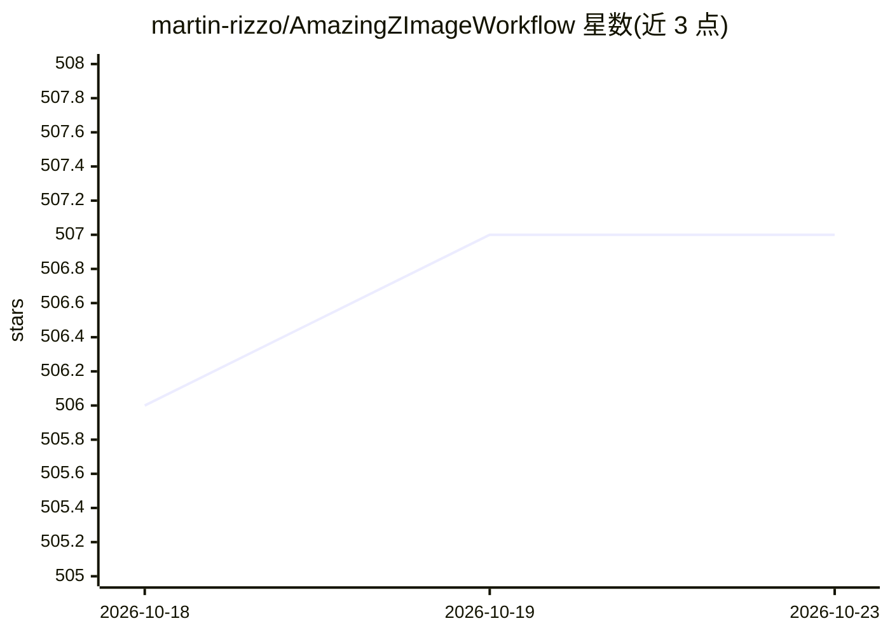

# martin-rizzo/AmazingZImageWorkflow

⭐ 507 · Python · Unlicense · 推送 2026-01-15 · [GitHub](https://github.com/martin-rizzo/AmazingZImageWorkflow) · [官网](https://civitai.com/models/2181458/amazing-z-image-workflow) · 个人维护

**ComfyUI 的 Z-Image-Turbo 出图工作流：18 种预设样式+精修放大**

面向 ComfyUI 用户的 Z-Image-Turbo 图像生成工作流包：在 ComfyUI 基础工作流上加入 18 种可选样式、二次精修（Refiner）、分辨率提升 50% 的放大器、横竖版切换与低步数提速开关等功能。提供 GGUF 与 SafeTensors 两种预配置版本，GGUF 版面向 12GB 或以下显存的 GPU。使用需自行下载 z_image_turbo 扩散模型、Qwen3-4B 文本编码器、VAE 与放大模型文件放入对应目录，并安装 rgthree-comfy、ComfyUI-GGUF 等自定义节点。生成图片按日期归档到 ZImage 文件夹。

## 筛选速览

| 维度 | 判定 | 备注 |
|---|---|---|
| AI 角色 | `ai-native` | 本体是模型或模型工具 |
| 许可风险 | `permissive` | Unlicense |
| 部署形态 | `None` |  |
| 模型依赖 | local-ok | 支持本地模型 |
| 硬件要求 | — | 无带数字的原话,不猜 |
| 安装摩擦 | `medium` | 含编译或系统依赖之一 |
| 成熟度 | — | 结构信号不足 |

## 能力要点

- 4 组工作流（通用/漫画/摄影）各含 18 种预设样式
- Refiner 二次精修 + Upscaler 放大，含照片/插画模式选择
- GGUF 与 SafeTensors 双版本，GGUF 版适配 12GB 以下显存
- 7 步速出、低分辨率、横版切换等易用开关

## 适用场景

- 在 ComfyUI 中通过样式选择器快速生成特定风格图片
- 显存有限的机器上用 GGUF 量化版跑 Z-Image-Turbo
- 对生成图做二次精修与分辨率放大

## 场景标签

`图像生成` · 领域:内容生成

## 证据(README 行号)

> L10: A workflow for Z-Image-Turbo that expands the ComfyUI base workflow with additional features, particularly focused 
> L15: - **Style Selector**: Choose from eighteen customizable image styles.

## 星数曲线

2026-10-18 506 → 2026-10-23 507（+1）

---
*卡片 v1 · prompt 1.4 · 生成 2026-10-21 · 置信度 high · 依据 README sha `8a53419303b3` · [字段定义](../../DATASET.md)*
