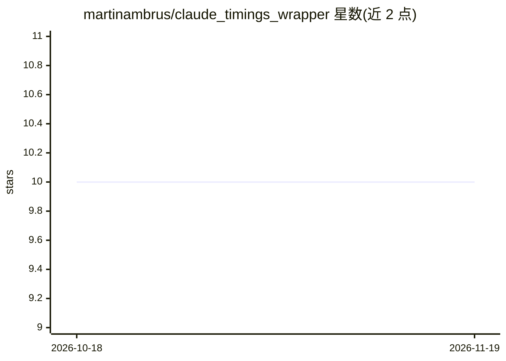

# martinambrus/claude_timings_wrapper

⭐ 10 · JavaScript · MIT · 推送 2026-06-05 · [GitHub](https://github.com/martinambrus/claude_timings_wrapper) · 个人维护

**统计 Claude Code 会话中空闲/输入/Agent 工作时间的包装器**

Node.js PTY 包装器，夹在终端与 claude 进程之间：通过拦截 stdin 检测用户输入、通过四个 Claude Code hooks（UserPromptSubmit/Stop/Notification/PreToolUse）驱动状态机，区分 idle、typing、agent working 三种时间并写入 ~/.claude/timings/ 下的 JSONL。支持按日/周统计、按项目分组、结合 git 提交做任务级时间归因；可选 LLM 归因与提示词捕获，播放完成提示音，并提供 --repair 修复历史会话数据。

## 筛选速览

| 维度 | 判定 | 备注 |
|---|---|---|
| AI 角色 | `ai-ecosystem` | LLM/agent 周边工具 |
| 许可风险 | `permissive` | MIT |
| 部署形态 | `desktop` | 安装包/桌面程序 |
| 模型依赖 | locked-api |  |
| 硬件要求 | — | 无带数字的原话,不猜 |
| 安装摩擦 | `high` | 编译与系统依赖俱全 |
| 成熟度 | — | 结构信号不足 |

## 能力要点

- PTY 包装 + Claude Code 四类 hooks 驱动的状态机计时
- 结合 git 提交历史的任务级时间分解与并行任务去重
- 检测 rate-limit 状态并即时停止 agent 计时
- --attribute-llm 用 headless claude 调用归因孤立提示词

## 适用场景

- 量化自己每天用 Claude Code 的时间分布
- 按项目/任务核算 AI 辅助开发的耗时
- 统计 rate-limit 造成的等待与空闲

## 场景标签

 · 领域:开发者工具/AI 编码效率度量

## 证据(README 行号)

> L7: `claude-timed` is a Node.js PTY wrapper that sits between your terminal and the `claude` process. It uses two mechan
> L10: 2. **Claude Code hooks** — Four hooks drive transitions:
> L35: Each transition is logged to a per-session JSONL file in `~/.claude/timings/`.

## 星数曲线

2026-10-18 10 → 2026-11-19 10（+0）

---
*卡片 v1 · prompt 1.4 · 生成 2026-11-19 · 置信度 high · 依据 README sha `36c4e45c4f9f` · [字段定义](../../DATASET.md)*
