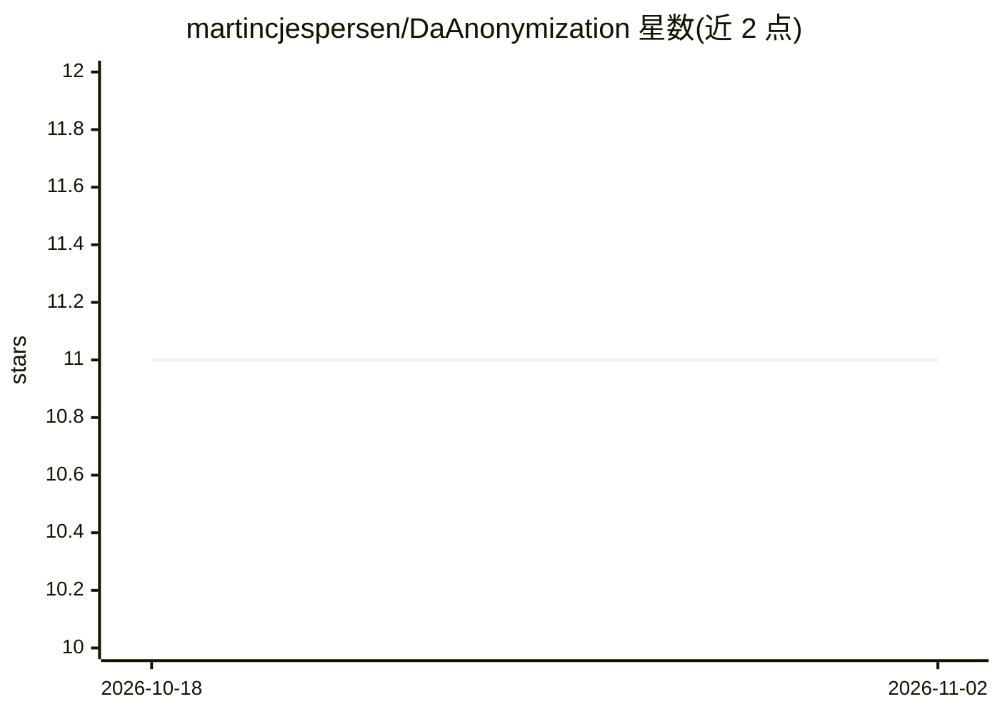

# martincjespersen/DaAnonymization

⭐ 11 · Python · Apache-2.0 · 推送 2026-04-02 · [GitHub](https://github.com/martincjespersen/DaAnonymization) · 个人维护

**丹麦语文本匿名化管道：NER 与正则脱敏**

基于 SpaCy 与 DaCy 的丹麦语文本匿名化流水线，通过命名实体识别（PER/LOC/ORG/MISC）与正则匹配识别并掩码 CPR、电话、邮箱等敏感信息。DaCy 建立在多语言 RoBERTa 之上，可处理混杂其他语言的噪声文本。支持自定义掩码函数、假名化模块（Person 1 等保持实体关联）、批量多进程处理与 Streamlit 演示网站。README 声明不保证移除全部敏感信息。以 Python 库形式通过 pip 提供。

## 筛选速览

| 维度 | 判定 | 备注 |
|---|---|---|
| AI 角色 | `ai-native` | 本体是模型或模型工具 |
| 许可风险 | `permissive` | Apache-2.0 |
| 部署形态 | `library` | 以包/库形式分发 |
| 模型依赖 | — | README 未给出锁定关系 |
| 硬件要求 | — | 无带数字的原话,不猜 |
| 安装摩擦 | `low` | 无编译、无系统依赖或容器化 |
| 成熟度 | — | 结构信号不足 |

## 能力要点

- NER（PER/LOC/ORG/MISC）与正则（CPR/电话/邮箱）掩码
- 基于 DaCy（多语言 RoBERTa）处理含其他语言的丹麦语文本
- 假名化模块（Person 1 等）与先验个体知识感知掩码
- 支持自定义掩码函数与批量多进程处理

## 适用场景

- 对丹麦语语料做匿名化处理再发布或共享
- 保留实体关联结构的假名化处理
- 按项目需求扩展自定义脱敏规则

## 场景标签

 · 领域:NLP/隐私保护

## 证据(README 行号)

> L14: A simple pipeline wrapped around SpaCy and DaCy for anonymizing danish corpora. The pipeline allows for custom func
> L16: The **DaCy model** is built on **multilingual RoBERTa** which enables **cross-lingual transfer** for other languagu

## 星数曲线

2026-10-18 11 → 2026-11-02 11（+0）

---
*卡片 v1 · prompt 1.4 · 生成 2026-11-02 · 置信度 high · 依据 README sha `66ef79d5ed6f` · [字段定义](../../DATASET.md)*
