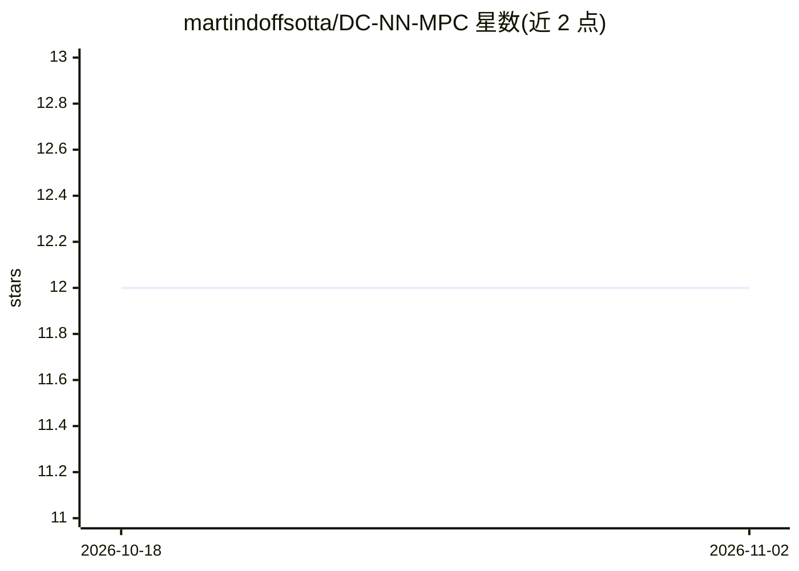

# martindoffsotta/DC-NN-MPC

⭐ 12 · Python · 推送 2026-09-08 · [GitHub](https://github.com/martindoffsotta/DC-NN-MPC) · 个人维护

**基于 DC 神经网络的鲁棒 tube MPC 研究代码，用于 PVTOL 飞行器控制**

Martin Doff-Sotta 维护的研究代码，实现基于学习的非线性鲁棒 tube MPC：用两个 Input-Convex Neural Network 堆叠成的 DC 神经网络近似系统动力学，通过逐次线性化将 MPC 表达为凸规划序列，并利用凸性收紧线性化误差界，作为有界扰动纳入鲁棒 MPC。示例应用于 PVTOL 飞行器模型，对应论文成果。以 Python 3 编写，依赖 CVXPY、MOSEK（需许可证）、TensorFlow/Keras，运行 main.py 执行，可选加载已有模型或重训、选择 tube 截面参数化方式（elem/splx）。

## 筛选速览

| 维度 | 判定 | 备注 |
|---|---|---|
| AI 角色 | `ai-native` | 本体是模型或模型工具 |
| 许可风险 | `none` | — |
| 部署形态 | `library` | 以包/库形式分发 |
| 模型依赖 | — | README 未给出锁定关系 |
| 硬件要求 | — | 无带数字的原话,不猜 |
| 安装摩擦 | `low` | 无编译、无系统依赖或容器化 |
| 成熟度 | — | 结构信号不足 |

## 能力要点

- DC 神经网络（两个 Input-Convex NN 堆叠）学习动力学
- 逐次线性化将 MPC 化为凸规划序列
- 凸性收紧线性化误差界并纳入鲁棒 tube MPC
- 提供 PVTOL 飞行器模型应用示例

## 适用场景

- 复现论文中的 DC 规划鲁棒 MPC 算法
- 研究学习型非线性系统控制的 tube 方法
- 以此为起点改造到其他动力学系统

## 场景标签

 · 领域:控制/优化（研究代码）

## 证据(README 行号)

> L10: Learning-based robust tube-based MPC of dynamic systems approximated by difference-of-convex (DC) Neural Network mo
> L13: In order to derive a sequence of convex programs, the dynamics are learned in DC form using DC Neural Network model

## 星数曲线

2026-10-18 12 → 2026-11-02 12（+0）

---
*卡片 v1 · prompt 1.4 · 生成 2026-11-01 · 置信度 mid · 依据 README sha `61e588a13d69` · [字段定义](../../DATASET.md)*
