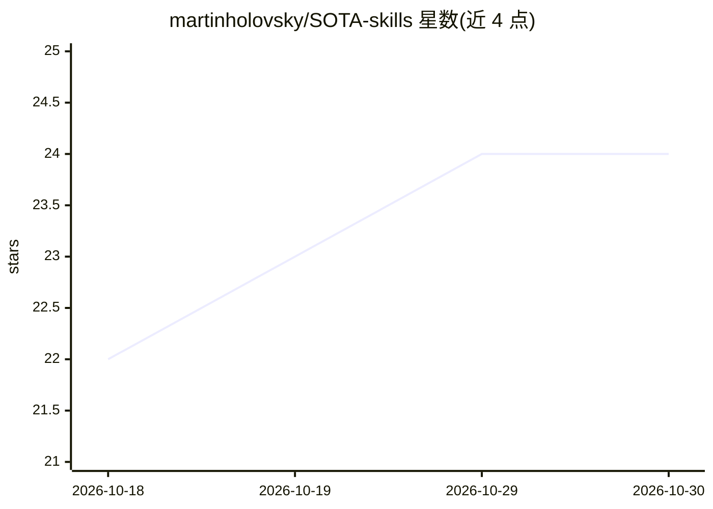

# martinholovsky/SOTA-skills

⭐ 24 · Python · CC-BY-4.0 · 推送 2026-10-29 · [GitHub](https://github.com/martinholovsky/SOTA-skills) · [官网](https://probably.group) · 个人维护

**给 AI 编程助手的工程规范技能库：43 个技能按任务路由加载**

面向 Claude Code 等 AI 编程 agent 的技能/规则库：43 个技能（348 个文件，约 9.3 万行）覆盖安全编码、云与身份、合规、语言规范与前端测试等实践，以路由机制按任务仅加载匹配规则、每轮重述并在交付前复查，使规则在长上下文中持续生效；提供 BUILD 与 AUDIT 两种模式及五个斜杠命令（会话恢复、收尾、审计、深度审计、报告）。安装方式为 Claude Code 插件市场命令或 git clone 后运行 install.sh（可 symlink 至各 agent 的 skills 目录）。README 声称最佳实践覆盖率从不加引导的约 59% 升至约 98%，并注明各数字对应的模型与测量日期。兼容 Antigravity CLI、Codex、Copilot、Cursor 等读取 AGENTS.md 或 skills 目录的 agent，但每轮重述为 Claude Code 专属 hook，经其他 agent 未测得提升。

## 筛选速览

| 维度 | 判定 | 备注 |
|---|---|---|
| AI 角色 | `ai-ecosystem` | LLM/agent 周边工具 |
| 许可风险 | `viral` | CC-BY-4.0 |
| 部署形态 | `self-host` | docker 或自建部署 |
| 模型依赖 | locked-api |  |
| 硬件要求 | — | 无带数字的原话,不猜 |
| 安装摩擦 | `low` | 无编译、无系统依赖或容器化 |
| 成熟度 | — | 结构信号不足 |

## 能力要点

- 43 个技能按任务路由加载，单个 instruction 文件不超过 500 行
- BUILD + AUDIT 双模式与 5 个斜杠命令（resume/close/audit/deep-audit/report）
- 内置 OWASP、SLSA、CIS、GDPR、NIST 等标准对照与审计探针
- 声明覆盖率 59%→98% 的测量结果并标注模型与日期

## 适用场景

- 让 AI 编程助手在编码时持续遵循安全与工程规范
- 对现有代码库跑规范审计并定位违反的控制项
- 会话收尾时整理未完成事项并生成报告

## 场景标签

`提示工程` `代码审查` · 领域:Agent 开发

## 证据(README 行号)

> L9:  SOTA Engineering Skills — 40+ Claude Code skills to build and audit software at state-of-the-art practices
> L19: It works by being a **loop, not a prompt dump**: route in only the rules a task needs,
> L22: instead of becoming one. Native on Claude Code; works with Antigravity CLI, Codex, and any

## 星数曲线

2026-10-18 22 → 2026-10-30 24（+2）

---
*卡片 v1 · prompt 1.4 · 生成 2026-10-27 · 置信度 mid · 依据 README sha `ac14c551a3fe` · [字段定义](../../DATASET.md)*
