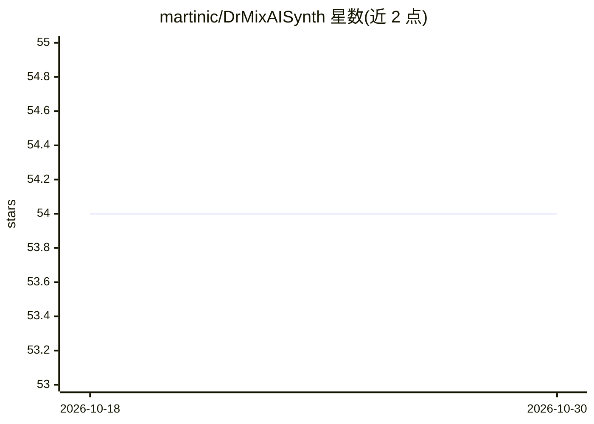

# martinic/DrMixAISynth

⭐ 54 · C++ · 推送 2026-09-01 · [GitHub](https://github.com/martinic/DrMixAISynth) · 组织维护

**由 ChatGPT 辅助编写的概念验证软件合成器插件**

Doctor Mix 与 Martinic 合作开发的概念验证（proof-of-concept）合成器插件，支持 AAX/AU/CLAP/VST2/VST3 五种插件格式，可在 macOS 等平台的音乐制作宿主中加载。项目代码在 AI 聊天机器人 ChatGPT 的辅助下编写，用于演示 AI 参与音频插件开发的过程。构建需要 C/C++ 编译器与 IPlug 框架等免费工具链，README 未提供成品安装包下载，需从源码自行编译。

## 筛选速览

| 维度 | 判定 | 备注 |
|---|---|---|
| AI 角色 | `ai-enhanced` | 去掉 AI 部分产品仍成立 |
| 许可风险 | `none` | — |
| 部署形态 | `None` |  |
| 模型依赖 | — | README 未给出锁定关系 |
| 硬件要求 | — | 无带数字的原话,不猜 |
| 安装摩擦 | `low` | 无编译、无系统依赖或容器化 |
| 成熟度 | `idea` | |

## 能力要点

- 支持 AAX/AU/CLAP/VST2/VST3 五种插件格式
- 代码由 ChatGPT 辅助编写
- 基于 IPlug 框架从源码构建

## 适用场景

- 在 DAW 中加载该合成器发出声音
- 了解 AI 辅助开发音频插件的实践案例

## 场景标签

 · 领域:音频/音乐制作

## 证据(README 行号)

> L3: Doctor Mix AI Synth is a proof-of-concept AAX/AU/CLAP/VST2/VST3 synthesizer
> L5: Martinic, coded with the help of the AI chatbot
> L6: ChatGPT.

## 星数曲线

2026-10-18 54 → 2026-10-30 54（+0）

---
*卡片 v1 · prompt 1.4 · 生成 2026-10-24 · 置信度 mid · 依据 README sha `db8656d83e09` · [字段定义](../../DATASET.md)*
