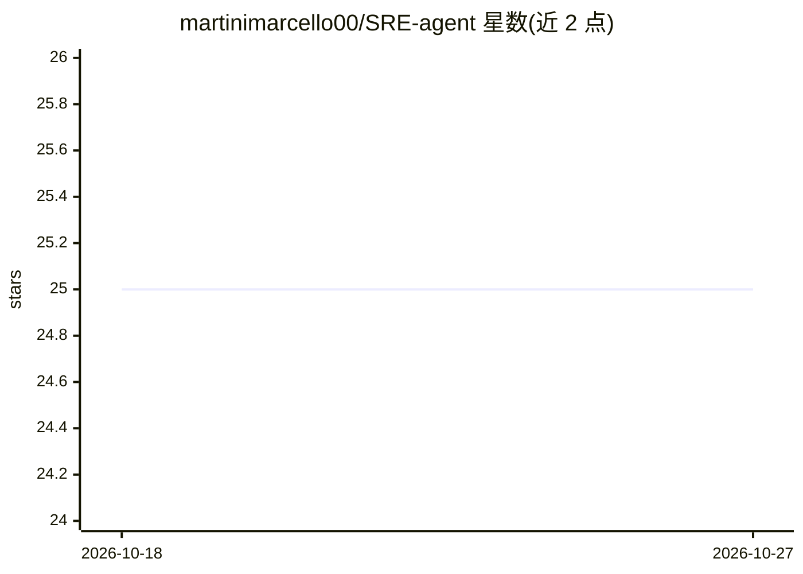

# martinimarcello00/SRE-agent

⭐ 25 · HTML · 推送 2026-10-22 · [GitHub](https://github.com/martinimarcello00/SRE-agent) · [官网](https://marcellomartini.tech/projects/sre-agent/) · 个人维护

**面向 Kubernetes 事故的 LLM 多智能体诊断与缓解系统**

基于 LangGraph 的多智能体系统，用于 Kubernetes 环境下的故障检测、根因分析与缓解。包含 Triage Agent（确定性启发式结合 LLM 推理）、拓扑感知的 Planner Agent、并行执行的 RCA Workers 与 Supervisor Agent，通过自定义 MCP Server 接入 Prometheus、Jaeger 与 Kubernetes API 等可观测性工具。集成 AIOpsLab 提供故障注入与自动化评测流水线，指标含检测准确率、定位准确率与 LLM-as-a-Judge 评分。运行需 Python 3.13+、Poetry、Docker/Kind 与 OpenAI API Key。

## 筛选速览

| 维度 | 判定 | 备注 |
|---|---|---|
| AI 角色 | `ai-ecosystem` | LLM/agent 周边工具 |
| 许可风险 | `none` | — |
| 部署形态 | `None` |  |
| 模型依赖 | — | README 未给出锁定关系 |
| 硬件要求 | — | 无带数字的原话,不猜 |
| 安装摩擦 | `low` | 无编译、无系统依赖或容器化 |
| 成熟度 | — | 结构信号不足 |

## 能力要点

- 四组件多智能体架构（Triage/Planner/RCA Workers/Supervisor）
- 自定义 MCP Server 接入 Prometheus/Jaeger/K8s API 并预压缩数据
- Datagraph 集群拓扑图引导调查，减少无关资源探索
- 基于 AIOpsLab 的故障注入与批量自动化实验流水线

## 适用场景

- Kubernetes 微服务故障的自动检测与根因定位
- 在 Hotel Reservation 等测试环境注入故障并评测 agent 表现
- SRE/AIOps 研究中的自动化事故响应实验

## 场景标签

`多智能体` · 领域:Agent 开发

## 证据(README 行号)

> L3: **sre-agent** is an autonomous multi-agent system designed to automate Incident Response in Kubernetes environments.
> L5: This system integrates with **AIOpsLab** for realistic fault injection and uses a custom **Model Context Protocol (M

## 星数曲线

2026-10-18 25 → 2026-10-27 25（+0）

---
*卡片 v1 · prompt 1.4 · 生成 2026-10-27 · 置信度 mid · 依据 README sha `9e9b4d668c6d` · [字段定义](../../DATASET.md)*
