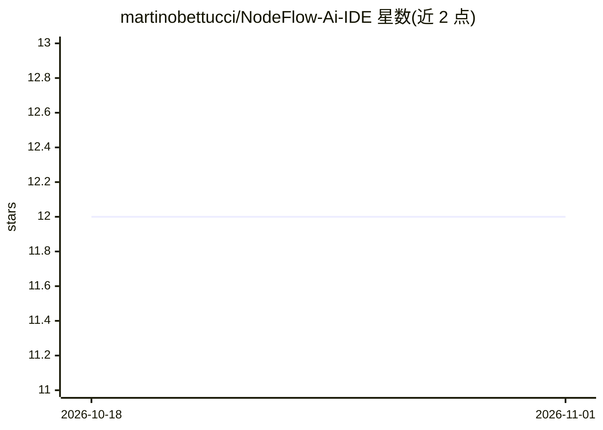

# martinobettucci/NodeFlow-Ai-IDE

⭐ 12 · TypeScript · AGPL-3.0 · 推送 2026-06-15 · [GitHub](https://github.com/martinobettucci/NodeFlow-Ai-IDE) · [官网](https://nodeflow-ide.netlify.app/) · 个人维护 · 中文 README

**可视化节点式 AI 工作流 IDE，浏览器端连接后端节点**

基于 ReactFlow 的浏览器画布 IDE，是 NodeFlow SDK 的纯客户端：自带文本/图像/音频/视频输入节点，所有处理节点来自后端（echo、Whisper、OpenAI、FAL.AI 封装后端或用户自建节点）。后端凭清单动态渲染节点参数，IDE 与后端间通过 RSA-PSS 握手会话通信，API key 不进入浏览器。支持按拓扑序执行整图工作流、WebSocket 实时进度、项目管理（IndexedDB 自动保存）。提供 Docker Compose 一键启动与 npm 本地开发两种方式。

## 筛选速览

| 维度 | 判定 | 备注 |
|---|---|---|
| AI 角色 | `ai-ecosystem` | LLM/agent 周边工具 |
| 许可风险 | `viral` | AGPL-3.0 |
| 部署形态 | `self-host` | docker 或自建部署 |
| 模型依赖 | — | README 未给出锁定关系 |
| 硬件要求 | — | 无带数字的原话,不猜 |
| 安装摩擦 | `low` | 无编译、无系统依赖或容器化 |
| 成熟度 | — | 结构信号不足 |

## 能力要点

- ReactFlow 画布，类型安全的多模态连线与节点内联预览
- 后端节点凭 manifest 动态渲染，零代码扩展
- RSA-PSS 会话握手，API key 仅保存在后端侧
- Docker Compose 一键启动 IDE 与官方 OpenAI/FAL.AI/Whisper 后端

## 适用场景

- 在浏览器中以拖拽节点方式搭建 AI 工作流
- 通过封装后端调用 OpenAI / FAL.AI 而不在前端暴露密钥
- 连接自建 NodeFlow SDK 后端扩展自定义节点

## 场景标签

`工作流自动化` · 领域:效率与自动化

## 证据(README 行号)

> L13: The IDE is a **pure NodeFlow SDK client**. It ships only *input* nodes
> L21: - **Thin wrappers for SaaS APIs.** Want OpenAI or FAL.AI? Serve the

## 星数曲线

2026-10-18 12 → 2026-11-01 12（+0）

---
*卡片 v1 · prompt 1.4 · 生成 2026-11-01 · 置信度 mid · 依据 README sha `b6a31758808b` · [字段定义](../../DATASET.md)*
