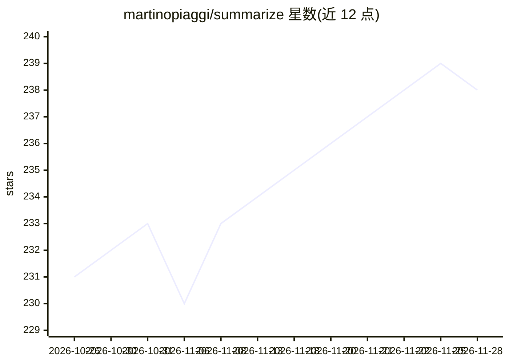

# martinopiaggi/summarize

⭐ 238 · Python · MIT · 推送 2026-11-22 · [GitHub](https://github.com/martinopiaggi/summarize) · [官网](https://summarize.martino.im) · 个人维护

**为个人用户把多平台视频转成 Markdown 摘要**

从 YouTube、TikTok、Instagram、X、Reddit、本地文件等 11+ 来源获取视频，转写并生成 Markdown 摘要（问答、事实核查、Mermaid 图、教程、文章等格式）。提供 CLI、Streamlit Web 界面、HTTP API、Telegram bot、Docker 与 Raycast 多种使用方式，带转写缓存与可选的 vision 模式。需 Python 3.10+、ffmpeg 与 OpenAI 兼容 API key；另提供 TranscriptFetch/Cobalt 侧车应对被封锁来源的转写回退。

## 筛选速览

| 维度 | 判定 | 备注 |
|---|---|---|
| AI 角色 | `ai-native` | 本体是模型或模型工具 |
| 许可风险 | `permissive` | MIT |
| 部署形态 | `self-host` | docker 或自建部署 |
| 模型依赖 | locked-api |  |
| 硬件要求 | — | 无带数字的原话,不猜 |
| 安装摩擦 | `low` | 无编译、无系统依赖或容器化 |
| 成熟度 | — | 结构信号不足 |

## 能力要点

- 11+ 视频来源（YouTube/X/Instagram/TikTok/本地文件等）本地化摘要
- 兼容任意 OpenAI-compatible LLM、Perplexity、LiteLLM
- CLI/Streamlit/HTTP API/Telegram bot/Docker/Raycast 多入口
- 转写缓存与可选 TranscriptFetch、Cobalt 侧车

## 适用场景

- 把长讲座视频转成结构化 Markdown 笔记
- 通过 Telegram bot 发链接直接取回摘要
- 为 YouTube 下载受限地区的视频获取转写

## 场景标签

`语音识别` `AI 写作` · 领域:内容生成

## 证据(README 行号)

> L9: - **11+ sources**: Local-first summarization for YouTube, Instagram, TikTok, X, Reddit, Facebook, Drive, Dropbox, lo
> L10: - **Bring your own API keys**: Works with any OpenAI-compatible LLM, Perplexity models, LiteLLM
> L25: Requires Python 3.10+, **ffmpeg** on `PATH`, and an OpenAI-compatible API key in `.env`.

## 星数曲线

2026-10-26 231 → 2026-11-28 238（+7）

---
*卡片 v1 · prompt 1.4 · 生成 2026-11-25 · 置信度 high · 依据 README sha `0927078deec0` · [字段定义](../../DATASET.md)*
