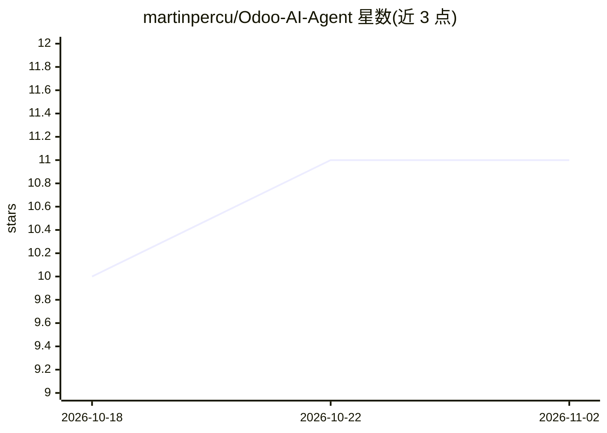

# martinpercu/Odoo-AI-Agent

⭐ 11 · TypeScript · 推送 2026-10-27 · [GitHub](https://github.com/martinpercu/Odoo-AI-Agent) · [官网](https://theodooagent.com) · 个人维护

**用自然语言查询和管理 Odoo ERP 的 AI 对话前端**

The Odoo Agent 的前端仓库：基于 Next.js 16/React 19/TypeScript/Supabase 的多租户 ChatGPT 风格界面，让用户以自然语言查询并管理 Odoo（销售、发票、库存、HR）。提供 SSE 流式聊天、AI 提议的带确认门 CRUD 操作、Recharts 交互图表与 Excel/PDF 导出、可固定洞察面板、主动通知、语音 STT/TTS、11 语言 i18n 与白标。对话智能本体（21 节点 LangGraph agent、多租户认证、OCR）在私有后端仓库，本仓库不含 AI 后端。

## 筛选速览

| 维度 | 判定 | 备注 |
|---|---|---|
| AI 角色 | `ai-native` | 本体是模型或模型工具 |
| 许可风险 | `none` | — |
| 部署形态 | `library` | 以包/库形式分发 |
| 模型依赖 | — | README 未给出锁定关系 |
| 硬件要求 | — | 无带数字的原话,不猜 |
| 安装摩擦 | `low` | 无编译、无系统依赖或容器化 |
| 成熟度 | `idea` | |

## 能力要点

- SSE 流式聊天与 AI 提议 CRUD 的确认/取消流程
- 交互式图表、自动 Excel 导出与 PDF 下载卡片
- Supabase 认证 + RBAC（SuperAdmin/Admin/Client）多租户与订阅层级
- 语音 STT/TTS（/transcribe 端点 + audio SSE 播放）与 11 语言界面

## 适用场景

- 通过对话查询和操作我的 Odoo 业务数据
- 在仪表盘中固定图表与导出文件做日常经营分析
- 作为实施方向客户交付白标 ERP AI 助手

## 场景标签

`AI 助手` `数据分析` · 领域:效率与自动化

## 证据(README 行号)

> L12: A multi-tenant, **ChatGPT-style interface** that lets anyone query and manage their Odoo ERP — sales, invoices, inv
> L16: > **This repo is the frontend.** The conversational intelligence — a **21-node LangGraph agent**, keyword-first/LLM
> L56: A modern, responsive interface that allows users to query and manage data from their Odoo instance (inventory, invo

## 星数曲线

2026-10-18 10 → 2026-11-02 11（+1）

---
*卡片 v1 · prompt 1.4 · 生成 2026-11-02 · 置信度 high · 依据 README sha `fbdadc76e9f5` · [字段定义](../../DATASET.md)*
