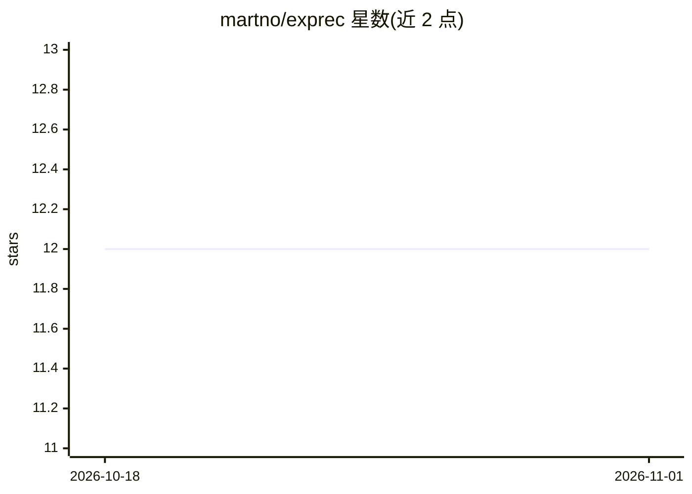

# martno/exprec

⭐ 12 · Python · MIT · 推送 2026-01-06 · [GitHub](https://github.com/martno/exprec) · 个人维护

**记录机器学习实验并支持对比与复现的 Python 工具**

面向机器学习/深度学习研究者的实验记录库：两行代码即可开始记录，框架无关。记录内容包括源代码、终端输出、运行时安装的包，并可跟踪超参数、随时间变化的标量（如训练 loss）与图像；实验数据全部保存在本地，不上传云端。提供终端命令启动的 Dashboard（默认 http://localhost:8080/），支持 --host 参数跨机器访问；API 含 set_parameter、add_scalar、add_image、open 等方法，examples/ 目录附带示例脚本。MIT 许可。

## 筛选速览

| 维度 | 判定 | 备注 |
|---|---|---|
| AI 角色 | `ai-ecosystem` | LLM/agent 周边工具 |
| 许可风险 | `permissive` | MIT |
| 部署形态 | `library` | 以包/库形式分发 |
| 模型依赖 | — | README 未给出锁定关系 |
| 硬件要求 | — | 无带数字的原话,不猜 |
| 安装摩擦 | `low` | 无编译、无系统依赖或容器化 |
| 成熟度 | — | 结构信号不足 |

## 能力要点

- 两行代码最小集成，框架无关
- 记录源代码、终端输出与已安装包
- 跟踪超参数、标量曲线与图像，数据仅存本地
- 终端命令启动 Dashboard 查看与对比实验

## 适用场景

- 记录训练运行的超参数与 loss 曲线，事后对比不同实验
- 保存源码与包环境信息以便复现结果
- 在本地浏览器 Dashboard 中查看实验记录

## 场景标签

`MLOps` · 领域:训练与推理

## 证据(README 行号)

> L3: Exprec records your experiments so you can compare different runs and easily reproduce results.
> L6: * Framework agnostic - works with any machine learning/deep learning framework
> L7: * Records source code, terminal output and installed packages. The user can also track hyperparameters, values over 

## 星数曲线

2026-10-18 12 → 2026-11-01 12（+0）

---
*卡片 v1 · prompt 1.4 · 生成 2026-11-01 · 置信度 high · 依据 README sha `ad3c10a37690` · [字段定义](../../DATASET.md)*
