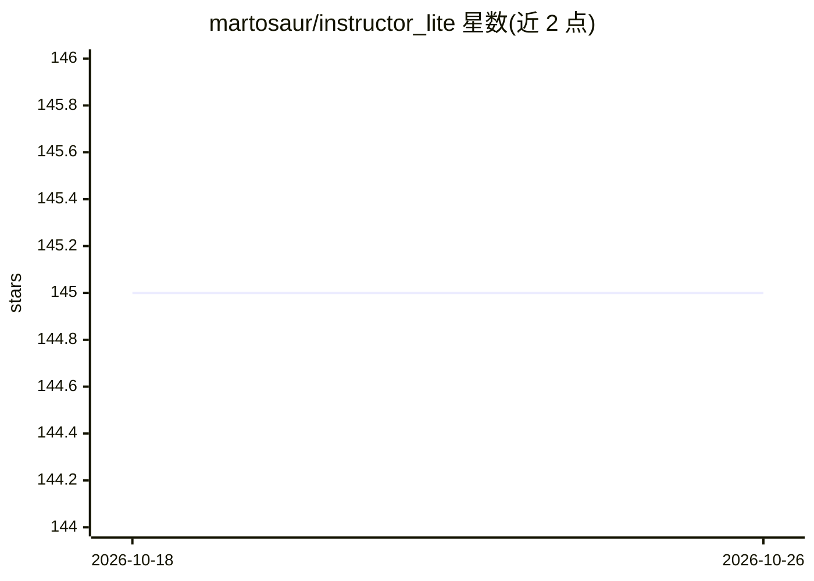

# martosaur/instructor_lite

⭐ 145 · Elixir · 推送 2026-10-12 · [GitHub](https://github.com/martosaur/instructor_lite) · 个人维护

**Elixir 结构化输出库：用 Ecto schema 约束 LLM 输出**

为 Elixir 应用提供将 LLM 输出映射到 Ecto schema 的基础组件库，是 instructor_ex 的 fork 与重写版。从 Ecto schema 生成 JSON schema，组织提示词、调用 LLM、转换与校验响应并支持校验失败重试；通过适配器接入 OpenAI、Anthropic、Gemini、Grok 等 Chat Completions 兼容 API 及 Llamacpp。设计上可通过选项覆盖各环节、不读取应用环境配置。明确声明不支持响应流式传输与统一接口。以 Hex 包安装。

## 筛选速览

| 维度 | 判定 | 备注 |
|---|---|---|
| AI 角色 | `ai-ecosystem` | LLM/agent 周边工具 |
| 许可风险 | `none` | — |
| 部署形态 | `None` |  |
| 模型依赖 | — | README 未给出锁定关系 |
| 硬件要求 | — | 无带数字的原话,不猜 |
| 安装摩擦 | `low` | 无编译、无系统依赖或容器化 |
| 成熟度 | — | 结构信号不足 |

## 能力要点

- 从 Ecto schema 生成 JSON schema
- 调用 LLM、转换与校验响应，校验失败可重试
- 适配 OpenAI/Anthropic/Gemini/Llamacpp 及 Chat Completions 兼容 API
- 配置不走应用环境，全部通过选项传入

## 适用场景

- 在 Elixir 应用中将非结构化文本提取为符合 Ecto schema 的结构化数据
- 为确定性业务逻辑提供形状可预测的 LLM 输出
- 校验失败时自动重试提示词以保证输出合规

## 场景标签

 · 领域:LLM 基础设施/结构化输出

## 证据(README 行号)

> L11: InstructorLite provides basic building blocks to embed LLMs into your
> L31: 1. It provides a very simple function for generating JSON schema from Ecto schema.
> L32: 2. It facilitates generating prompts, calling LLMs, casting and validating responses, including retrying prompts wh

## 星数曲线

2026-10-18 145 → 2026-10-26 145（+0）

---
*卡片 v1 · prompt 1.4 · 生成 2026-10-22 · 置信度 high · 依据 README sha `7e172913bfd3` · [字段定义](../../DATASET.md)*
