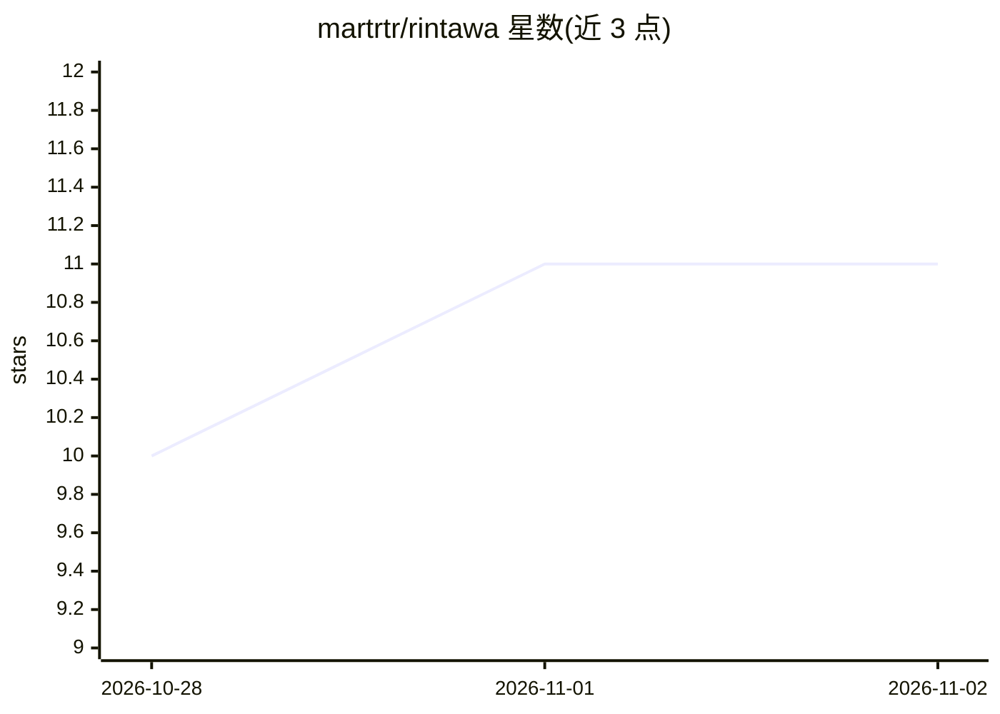

# martrtr/rintawa

⭐ 11 · Rust · GPL-3.0 · 推送 2026-10-27 · [GitHub](https://github.com/martrtr/rintawa) · 个人维护

**本地优先的持久交互世界运行时引擎**

Rust 编写的本地优先运行时，用于构建持久化交互世界：管理世界状态、扩展执行、权限与呈现层，通过内容寻址的 RTW 包实现可配置体验。核心机制包括 SQLite 支持的状态恢复、带版本契约的隔离扩展执行、扩展提供的可移植 UI。标准 Web 界面与应用包在独立仓库 rtwKit 中维护。自述处于早期开发阶段，完整 0.0.1 体验未发布，需从源码构建。

## 筛选速览

| 维度 | 判定 | 备注 |
|---|---|---|
| AI 角色 | `ai-ecosystem` | LLM/agent 周边工具 |
| 许可风险 | `viral` | GPL-3.0 |
| 部署形态 | `None` |  |
| 模型依赖 | — | README 未给出锁定关系 |
| 硬件要求 | — | 无带数字的原话,不猜 |
| 安装摩擦 | `low` | 无编译、无系统依赖或容器化 |
| 成熟度 | `idea` | |

## 能力要点

- 持久世界：权威状态变更、事件与 SQLite 支持的恢复
- 带版本契约与隔离执行的组合式扩展
- 内容寻址的 RTW 包，显式安装与激活
- CLI 管理已安装的 RTW 构件并启动组合

## 适用场景

- 为交互叙事/角色扮演世界搭建状态与扩展运行时
- 通过 RTW 包分发与组合世界内容
- 本地运行持久化世界体验（含聊天类工作流）

## 场景标签

`Agent 框架` · 领域:Agent 开发

## 证据(README 行号)

> L11: Rintawa is a local-first runtime for persistent interactive worlds. It manages
> L18: - **Composable extensions:** versioned contracts, scoped services and isolated execution.

## 星数曲线

2026-10-28 10 → 2026-11-02 11（+1）

---
*卡片 v1 · prompt 1.4 · 生成 2026-11-02 · 置信度 mid · 依据 README sha `3af0c0a70721` · [字段定义](../../DATASET.md)*
