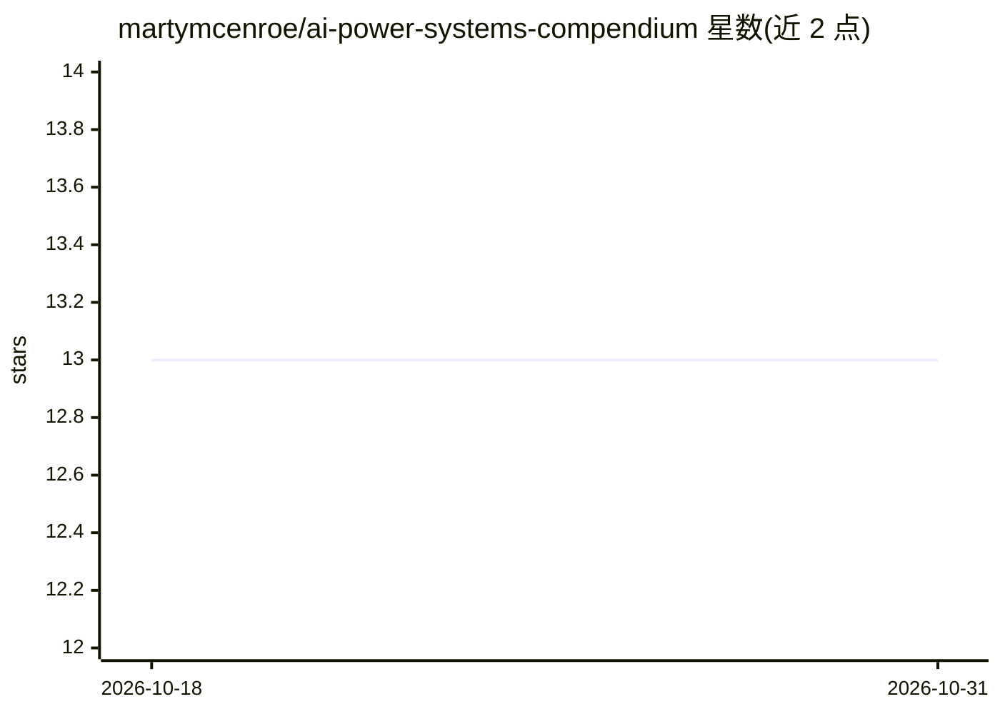

# martymcenroe/ai-power-systems-compendium

⭐ 13 · NOASSERTION · 推送 2026-09-26 · [GitHub](https://github.com/martymcenroe/ai-power-systems-compendium) · 个人维护

**电力系统与公用事业领域 AI/ML 资源策展清单**

由一位电力专业注册工程师（PE, Power）兼企业架构师维护的资源汇编：收录面向大电网（BPS）与公用事业部门的 AI/ML 资源，涵盖基础开源项目（PyPSA、GridFM、OpenSTEF、HELICS 等）、生成式 AI/预测性维护/电网韧性与数字孪生方向的行业论文、以及 LF Energy 等组织信息。按 PE 工程师、数据科学家、AI 架构师三类角色提供入门路径导航。面向从事电网现代化、可再生能源接入、负荷预测与预测性维护的工程师、数据科学家与管理者。仓库本身为清单，不含可安装运行的代码。

## 筛选速览

| 维度 | 判定 | 备注 |
|---|---|---|
| AI 角色 | `ai-knowledge` | 知识聚合/清单类 |
| 许可风险 | `none` | NOASSERTION |
| 部署形态 | `None` |  |
| 模型依赖 | — | README 未给出锁定关系 |
| 硬件要求 | — | 无带数字的原话,不猜 |
| 安装摩擦 | `low` | 无编译、无系统依赖或容器化 |
| 成熟度 | — | 结构信号不足 |

## 能力要点

- 按三类角色（PE 工程师/数据科学家/AI 架构师）提供策展入门路径
- 收录 PyPSA、GridFM、OpenSTEF、HELICS 等电力领域开源项目
- 按生成式 AI、预测性维护、电网韧性与数字孪生等主题组织论文与行业研究
- 收录 LF Energy 及其 AI SIG、GMLC 等组织条目

## 适用场景

- 查找电力系统领域专用的 AI/ML 开源工具与研究论文
- 按自身角色（工程师/数据科学家/架构师）获取入门路线
- 了解电网韧性、数字孪生与生成式 AI 在电力行业的应用资料

## 场景标签

`精选清单` · 领域:学习与行业

## 证据(README 行号)

> L3: An authoritative compendium of Artificial Intelligence (AI) and Machine Learning (ML) resources for the Bulk Power S
> L53: A curated list of foundational papers and recent research on the application of AI, ML, and GenAI to power systems.

## 星数曲线

2026-10-18 13 → 2026-10-31 13（+0）

---
*卡片 v1 · prompt 1.4 · 生成 2026-10-31 · 置信度 high · 依据 README sha `bebe17a13955` · [字段定义](../../DATASET.md)*
