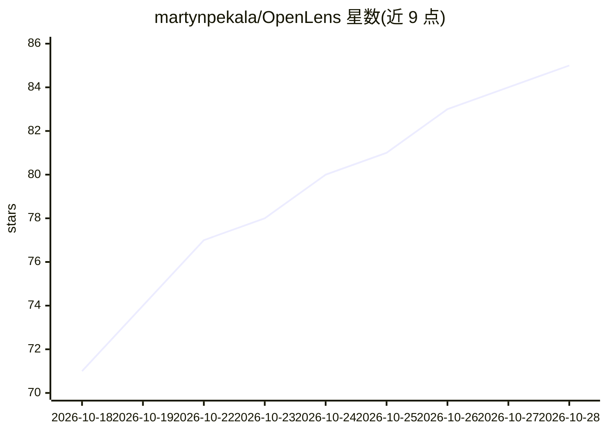

# martynpekala/OpenLens

⭐ 85 · Swift · MIT · 推送 2026-10-23 · [GitHub](https://github.com/martynpekala/OpenLens) · [官网](https://tryopenlens.site) · 个人维护

**在 iPhone/iPad 上连接 OpenCode 服务器的 iOS 客户端应用**

OpenLens 是一个原生 iOS/iPadOS 应用，通过连接运行在 Mac 上的 OpenCode 服务器，让用户在手机上与 AI 编程助手对话。功能包括会话聊天、审查与回滚变更、浏览工作区文件、应答 agent 提问与权限审批、查看 token 用量与模型切换。连接方式支持 QR 码配对（opencode pair，含 --remote 隧道）、Bonjour 自动发现、手动输入与 openlens:// 深链。要求 iOS/iPadOS 26+ 与 macOS 服务器，通过 App Store 或 XcodeGen 源码构建分发。

## 筛选速览

| 维度 | 判定 | 备注 |
|---|---|---|
| AI 角色 | `ai-ecosystem` | LLM/agent 周边工具 |
| 许可风险 | `permissive` | MIT |
| 部署形态 | `None` |  |
| 模型依赖 | — | README 未给出锁定关系 |
| 硬件要求 | — | 无带数字的原话,不猜 |
| 安装摩擦 | `low` | 无编译、无系统依赖或容器化 |
| 成熟度 | — | 结构信号不足 |

## 能力要点

- QR 配对/Bonjour 发现/手动 URL/深链多种连接方式，凭据存 Keychain
- 会话聊天、变更审查与单次回滚、工作区文件浏览
- 应答 agent 提问、权限审批、token 用量与模型切换
- Live Activities 在锁屏与灵动岛显示 agent 进度

## 适用场景

- 离开键盘后继续与 OpenCode 编程助手对话
- 在手机上审查 agent 的代码变更并回滚单次更新
- 远程应答 agent 的提问与权限请求

## 场景标签

`编码 Agent` · 领域:编码与开发

## 证据(README 行号)

> L9: OpenLens connects to an OpenCode server running on your Mac and gives you a native iPhone and iPad interface to chat
> L32: - **Native session chat** — rich Markdown rendering, code blocks, thinking indicators, agent activity cards, permis

## 星数曲线

2026-10-18 71 → 2026-10-28 85（+14）

---
*卡片 v1 · prompt 1.4 · 生成 2026-10-24 · 置信度 high · 依据 README sha `2e758ca58b19` · [字段定义](../../DATASET.md)*
