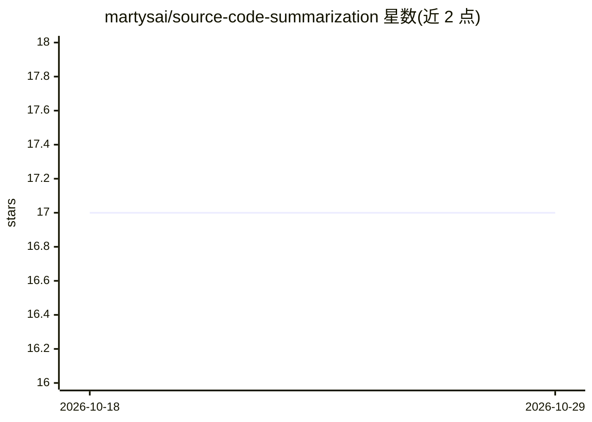

# martysai/source-code-summarization

⭐ 17 · Python · 推送 2026-02-16 · [GitHub](https://github.com/martysai/source-code-summarization) · 个人维护

**微调小型代码 LLM 为 Python 函数生成 docstring 并做 AST 评测**

对 1-3B 参数代码 LLM 做 LoRA/QLoRA 微调，基于 C2NL 种子数据（92k 例）与 teacher LLM 数据扩展，用于生成 Python 函数的 docstring；提供 FastAPI 推理服务，以 ollama 为后端支持多个 Qwen Coder 模型，生成 NumPy 风格文档。评测部分除 BLEU/ROUGE 外提供 AST 感知指标，检查文档是否正确引用标识符、控制流与参数。训练需 1-2 块 A100 GPU；原种子数据 Google Drive 链接已失效，需另行获取。

## 筛选速览

| 维度 | 判定 | 备注 |
|---|---|---|
| AI 角色 | `ai-native` | 本体是模型或模型工具 |
| 许可风险 | `none` | — |
| 部署形态 | `library` | 以包/库形式分发 |
| 模型依赖 | local-ok | 支持本地模型 |
| 硬件要求 | — | 无带数字的原话,不猜 |
| 安装摩擦 | `low` | 无编译、无系统依赖或容器化 |
| 成熟度 | — | 结构信号不足 |

## 能力要点

- LoRA/QLoRA（4-bit）微调小代码 LLM 生成 docstring
- AST 感知评测：检查标识符、控制流、参数引用的正确性
- FastAPI 推理服务，ollama 后端，支持 Qwen 2.5/3 Coder 多模型
- distilabel 调用 teacher LLM 扩充种子数据集

## 适用场景

- 为存量 Python 代码批量补写函数 docstring
- 研究代码摘要模型的训练与结构化评测方法
- 搭建本地 docstring 生成 API 服务

## 场景标签

`微调` `模型评测` · 领域:评测与运维

## 证据(README 行号)

> L7: This project fine-tunes small code LLMs (1-3B parameters) via LoRA to generate
> L8: docstrings for Python functions, and evaluates them using an AST-aware benchmark

## 星数曲线

2026-10-18 17 → 2026-10-29 17（+0）

---
*卡片 v1 · prompt 1.4 · 生成 2026-10-29 · 置信度 high · 依据 README sha `61539a0f0e21` · [字段定义](../../DATASET.md)*
