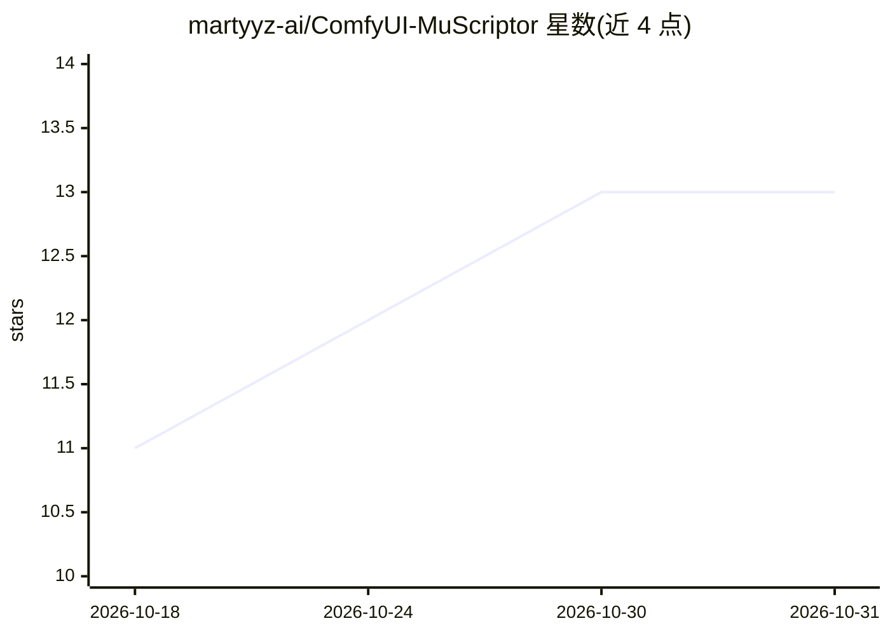

# martyyz-ai/ComfyUI-MuScriptor

⭐ 13 · Python · MIT · 推送 2026-07-23 · [GitHub](https://github.com/martyyz-ai/ComfyUI-MuScriptor) · 个人维护

**在 ComfyUI 中把多乐器音频转写为 MIDI 的自定义节点**

面向 ComfyUI 用户的自定义节点扩展，集成 Kyutai 与 Mirelo 开发的 MuScriptor 多乐器音乐转写模型：读取 AUDIO 端口或本地音频文件（WAV/MP3/FLAC 等），生成 .mid 文件与结构化 JSON 音符事件。提供 small/medium/large 三档模型（103M/307M/1.4B）、约 35 种乐器组过滤、采样温度/束搜索等解码参数，支持 cuda/cpu/mps 设备与 float32/16/bfloat16 精度，模型权重经 HuggingFace 下载并需先接受许可。安装方式为克隆到 custom_nodes 并 pip 安装依赖。

## 筛选速览

| 维度 | 判定 | 备注 |
|---|---|---|
| AI 角色 | `ai-native` | 本体是模型或模型工具 |
| 许可风险 | `permissive` | MIT |
| 部署形态 | `library` | 以包/库形式分发 |
| 模型依赖 | — | README 未给出锁定关系 |
| 硬件要求 | — | 无带数字的原话,不猜 |
| 安装摩擦 | `medium` | 含编译或系统依赖之一 |
| 成熟度 | — | 结构信号不足 |

## 能力要点

- 音频转多乐器 MIDI，输出 .mid 路径与音符事件 JSON
- small/medium/large 三档模型（103M/307M 默认/1.4B）
- 按乐器组过滤转写输出（钢琴、弦乐、铜管、鼓等）
- 支持 cuda/cpu/mps 设备与采样温度、束搜索等解码参数

## 适用场景

- 在 ComfyUI 工作流中把音频素材转成 MIDI 继续编辑
- 限制特定乐器组做分轨转写
- 批量音频转 MIDI 的自动化流水线

## 场景标签

 · 领域:音频/音乐 AI 工具

## 证据(README 行号)

> L9: **ComfyUI-MuScriptor** is a custom node extension for ComfyUI that integrates MuScriptor, a state-of-the-art multi-i
> L11: It transcribes multi-instrument audio (WAV, MP3, FLAC, etc.) into high-quality MIDI files directly inside your Comf

## 星数曲线

2026-10-18 11 → 2026-10-31 13（+2）

---
*卡片 v1 · prompt 1.4 · 生成 2026-10-31 · 置信度 mid · 依据 README sha `8e675a5ec4ab` · [字段定义](../../DATASET.md)*
