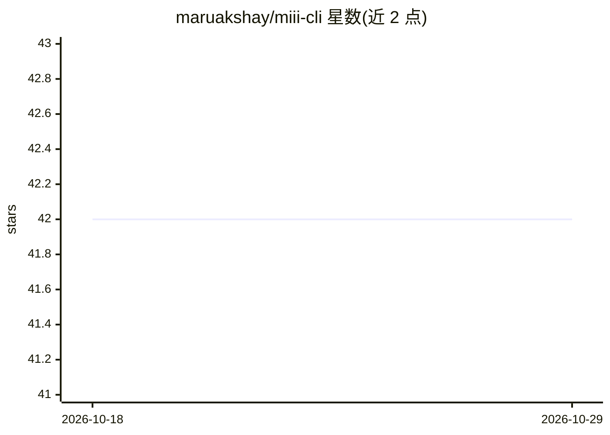

# maruakshay/miii-cli

⭐ 42 · TypeScript · MIT · 推送 2026-10-27 · [GitHub](https://github.com/maruakshay/miii-cli) · [官网](https://miii.in/) · 个人维护

**免费开源的终端/浏览器 AI 编程 agent，可离线本地运行**

MIT 许可的本地优先 AI 编程 agent，以 npm CLI 与 localhost Web UI 两种形式提供：规划、编辑、运行并测试代码，支持 14+ LLM 提供商（Claude/GPT/Gemini/DeepSeek 等）并可经 /provider 中途切换，也可用 Ollama、LM Studio、llama.cpp 或 vLLM 完全离线运行。机制上包含计划模式、修复直到测试通过（miii fix）、回滚检查点、MCP 子代理、CI 无头模式；每次文件写入与 shell 命令需先获批准，无遥测。需 Node 18+，本地模型按 VRAM 给出选型表，无 GPU 也可用托管 API。

## 筛选速览

| 维度 | 判定 | 备注 |
|---|---|---|
| AI 角色 | `ai-native` | 本体是模型或模型工具 |
| 许可风险 | `permissive` | MIT |
| 部署形态 | `library` | 以包/库形式分发 |
| 模型依赖 | local-ok | 支持本地模型 |
| 硬件要求 | — | 无带数字的原话,不猜 |
| 安装摩擦 | `low` | 无编译、无系统依赖或容器化 |
| 成熟度 | — | 结构信号不足 |

## 能力要点

- 14+ LLM 提供商，支持 Ollama/LM Studio/llama.cpp/vLLM 完全离线运行
- miii fix 循环运行测试并修复直至通过，无益尝试自动回滚
- 每次写入与命令需批准，/rewind 同时回滚文件与对话
- mcp 子代理、hooks 与 miii -p 无头模式可接入 CI/CD

## 适用场景

- 在终端里让 AI 重构模块、修失败测试并验证
- 用本地模型离线编写代码，代码不出 localhost
- 在 CI 流水线中以无头模式运行编码 agent
- 用已有 API key 复用 Claude/GPT/Gemini 做结对编程

## 场景标签

`编码 Agent` · 领域:编码与开发

## 证据(README 行号)

> L4:  It plans, edits, runs and tests code. Use any model: Claude, GPT, Gemini, DeepSeek,
> L21: - **Any LLM, one CLI.** 14+ providers, and you can switch mid-session with `/provider`.

## 星数曲线

2026-10-18 42 → 2026-10-29 42（+0）

---
*卡片 v1 · prompt 1.4 · 生成 2026-10-25 · 置信度 high · 依据 README sha `e766618d52e3` · [字段定义](../../DATASET.md)*
