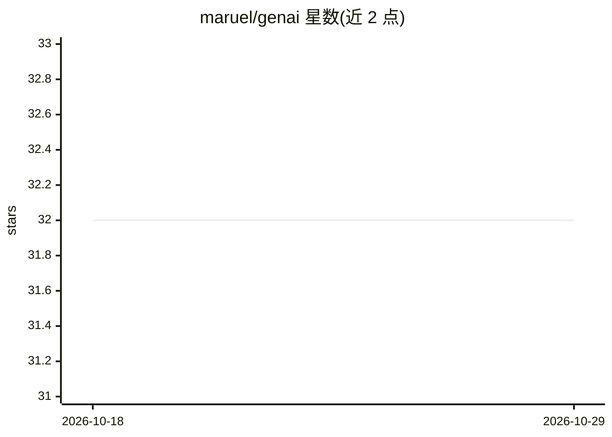

# maruel/genai

⭐ 32 · Go · Apache-2.0 · 推送 2026-10-26 · [GitHub](https://github.com/maruel/genai) · 个人维护

**Go 语言的 LLM 多后端 SDK：一套类型安全 API 接入 20+ 家模型服务商**

面向 Go 开发者的生成式 AI 客户端库，为 Anthropic、OpenAI、Gemini、DeepSeek、Ollama、llama.cpp 等 27 个后端提供统一接口，每个后端均可访问原生 API 与完整消息 schema（Go struct）。核心机制：通过反射定义工具调用、struct 声明 JSON 输出 schema 并解码回复、SystemOne 类型化决策推理、go 1.23 迭代器流式输出、HTTP 层录制回放的冒烟测试，以及基于实测行为生成的服务商功能计分板。支持图像/PDF/音频/视频多模态、网页搜索与引用生成。库无全局状态、依赖精简。限制：未标注版本成熟度，计分板列明各后端未支持的功能。

## 筛选速览

| 维度 | 判定 | 备注 |
|---|---|---|
| AI 角色 | `ai-ecosystem` | LLM/agent 周边工具 |
| 许可风险 | `permissive` | Apache-2.0 |
| 部署形态 | `library` | 以包/库形式分发 |
| 模型依赖 | local-ok | 支持本地模型 |
| 硬件要求 | — | 无带数字的原话,不猜 |
| 安装摩擦 | `low` | 无编译、无系统依赖或容器化 |
| 成熟度 | — | 结构信号不足 |

## 能力要点

- 统一 API 覆盖 27 个后端，含本地运行的 Ollama 与 llama.cpp
- 工具调用与 JSON schema 通过 Go struct 反射定义，无需手写 JSON
- HTTP 层录制/回放 API 调用，测试无需重复付费
- 基于实测行为生成各服务商功能计分板

## 适用场景

- Go 项目接入多家 LLM 服务商并按需切换
- 构建带工具调用与结构化输出的 agent 应用
- 本地 Ollama/llama.cpp 与云端模型共用同一套代码

## 场景标签

`模型网关` · 领域:Agent 开发

## 证据(README 行号)

> L3: The opinionated high performance professional-grade AI package for Go.
> L53: |Provider|🌐|Mode|➛In|Out➛|Tool|JSON|Batch|File|Cite|Text|Probs|Limits|Usage|Finish|
> L69: |llamacpp|🏠|Sync, Stream, SystemOne, Embed🧠|🎤💬📸|🎯💬🧬|✅🪨🔀|✅[]|❌|❌|❌|🌱📏🛑|✅|❌|✅|✅|

## 星数曲线

2026-10-18 32 → 2026-10-29 32（+0）

---
*卡片 v1 · prompt 1.4 · 生成 2026-10-26 · 置信度 high · 依据 README sha `be64d96f0944` · [字段定义](../../DATASET.md)*
